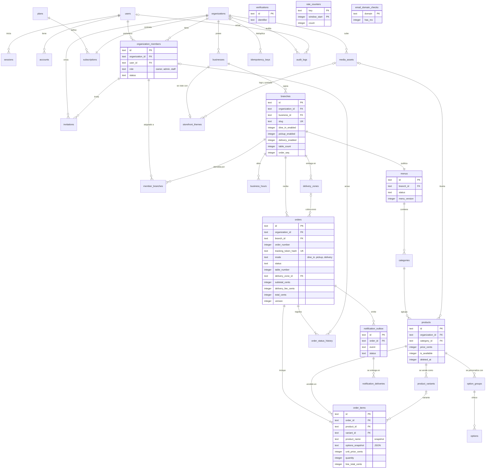

# Esquema de base de datos de MenusMax (MVP 1.0)

Diseño de datos listo para implementar en `packages/database`: alcance, modelo, migraciones SQL para Cloudflare D1 y consultas de verificación.

**Fuentes.** `README.md`, `ADR.md` (001–019), `apps/api/AGENTS.md`, `apps/web/AGENTS.md`, `DESIGN.md`, y el repositorio `Draggodeidad/menu-max` en el commit `119a9ea` (incluye `apps/api/docs/PLAN-BACKEND.md` y los datos simulados del frontend en `apps/web/src/lib/server/demo.ts`).

**Estado del repositorio.** No existe `packages/database` ni ninguna migración (T03 está pendiente; `wrangler.jsonc` aún no declara el binding `DB`). Por eso estas son las migraciones iniciales: no hay datos que preservar ni cambios incrementales que proponer.

**Cómo se verificó.** Apliqué las siete migraciones desde cero en SQLite 3.53 con llaves foráneas activas y ejecuté todas las consultas y comprobaciones de la sección 4; los resultados que cito salen de esa corrida. No se ejecutó contra D1 ni Miniflare: esa corrida corresponde a las pruebas de integración de T03 (`wrangler d1 migrations apply DB --local`).

## Índice

1. [Alcance y supuestos](#1-alcance-y-supuestos)
2. [Modelo de datos](#2-modelo-de-datos)
3. [Migraciones ejecutables](#3-migraciones-ejecutables)
4. [Consultas de ejemplo y verificación](#4-consultas-de-ejemplo-y-verificación)
5. [Decisiones](#5-decisiones)

---

## 1. Alcance y supuestos

### 1.1 Flujos del MVP que cubre el esquema

| Flujo                                                                     | Origen                          | Tablas que toca                                                                                                                                    |
| ------------------------------------------------------------------------- | ------------------------------- | -------------------------------------------------------------------------------------------------------------------------------------------------- |
| Publicar menú en un solo envío (`/crear` → `POST /v1/onboarding`)         | DESIGN §7.1, ADR-008            | `users`, `organizations`, `subscriptions`, `organization_members`, `businesses`, `branches`, `menus`, `categories`, `products`, `idempotency_keys` |
| Entrar, verificar correo, restablecer contraseña                          | ADR-005, ADR-008                | `users`, `sessions`, `accounts`, `verifications`, `email_domain_checks`, `rate_counters`                                                           |
| Equipo: invitar, asignar sucursales a `staff`                             | ADR-007, T14                    | `invitations`, `organization_members`, `member_branches`                                                                                           |
| Ajustes: modalidades, horarios, zonas, mesas, tema, WhatsApp              | DESIGN §7.1 F                   | `branches`, `business_hours`, `delivery_zones`, `storefront_themes`, `media_assets`                                                                |
| Catálogo: categorías, productos, variantes, extras, fotos, disponibilidad | README §2, T17–T18              | `categories`, `products`, `product_variants`, `option_groups`, `options`, `media_assets`, `menus.menu_version`                                     |
| Menú público y QR (`/m/[slug]`, `?mesa=n`)                                | DESIGN §7.2 H, ADR-014, ADR-017 | Lectura de catálogo, tema, horarios y zonas por `branches.slug`                                                                                    |
| Pedido como invitado en Mesa, Recoger o Domicilio                         | DESIGN §7.2 I, ADR-010, ADR-013 | `orders`, `order_items`, `order_status_history`, `notification_outbox`, `idempotency_keys`, `branches.order_seq`                                   |
| Seguimiento por token (`/pedido/[token]`)                                 | ADR-013                         | Lectura de `orders`, `order_items`, `order_status_history`                                                                                         |
| Operar pedidos en el panel (aceptar, preparar, listo, entregar, rechazar) | DESIGN §7.1 D, ADR-007          | `orders`, `order_status_history`, `notification_outbox`                                                                                            |
| Aviso por WhatsApp al negocio y, con consentimiento, al comensal          | ADR-011, ADR-019                | `notification_outbox`, `notification_deliveries`                                                                                                   |
| Planes y límites, auditoría                                               | README §2, T15, T26             | `plans`, `subscriptions`, `audit_logs`                                                                                                             |

Las 31 tablas son exactamente las del ADR-016. No agregué ninguna.

### 1.2 Supuestos adoptados

Todos son reversibles. La última columna dice qué costaría cambiarlos.

| #   | Supuesto                                                                                                                                       | Motivo                                                                                                                           | Para revertirlo                                                              |
| --- | ---------------------------------------------------------------------------------------------------------------------------------------------- | -------------------------------------------------------------------------------------------------------------------------------- | ---------------------------------------------------------------------------- |
| S1  | El slug público vive en `branches`, es único global, no cambia una vez publicado y no se libera al borrar la sucursal.                         | ADR-016 fija un menú por sucursal y el pedido se registra contra una sucursal; el QR impreso debe ser permanente.                | Mover el slug a `businesses` es una migración _expand/contract_.             |
| S2  | Las mesas son un número: `branches.table_count` y `orders.table_number`. El QR no se guarda; se genera desde `slug` y `mesa`.                  | ADR-016 no incluye `tables` ni `qr_codes`; el frontend ya maneja `mesas: number`.                                                | Tabla `tables` con token propio (ver 1.4).                                   |
| S3  | Un solo estado final de éxito, `delivered`, para las tres modalidades.                                                                         | El README sugiere `completed` y `delivered`; DESIGN y el frontend usan "Entregado" / `delivered` en todas.                       | Agregar `completed` al CHECK (reconstrucción de `orders`, §3.3).             |
| S4  | Los precios incluyen impuestos; no hay columnas de impuesto. `discount_cents` existe pero vale 0 en el MVP.                                    | "Impuestos" sigue pendiente en README §20. La columna de descuento evita reconstruir `orders` para cambiar la fórmula del total. | Columna `tax_cents` y nuevo CHECK del total (reconstrucción).                |
| S5  | Entrega por zonas con lista de códigos postales en JSON; la dirección se guarda como una línea más código postal y referencias.                | ADR-018 (Propuesto); el checkout actual tiene un solo campo de dirección.                                                        | Si ADR-018 cambia, solo cambia `delivery_zones.postal_codes`.                |
| S6  | `orders.anonymized_at` y `customer_phone_hash` existen desde ahora.                                                                            | ADR-015 (Propuesto). Agregar después el CHECK de anonimización obligaría a reconstruir `orders`.                                 | Si se rechaza ADR-015, las columnas quedan sin uso.                          |
| S7  | Un número de WhatsApp para avisos por sucursal (`branches.notify_whatsapp_*`); el consentimiento del comensal se guarda por pedido.            | `/crear` pide un solo "WhatsApp para avisos"; ADR-016 quitó `notification_preferences`.                                          | Varios destinatarios requieren una tabla nueva.                              |
| S8  | Los pedidos de prueba del dueño llevan `orders.is_test = 1`.                                                                                   | ADR-008 permite el pedido de prueba sin verificar; así no cuentan en estadísticas ni generan avisos.                             | Quitar la columna.                                                           |
| S9  | Límites del plan como columnas (`NULL` = sin límite); se siembra un plan `free` sin límites; los estados de `subscriptions` son provisionales. | "Planes" está pendiente en README §20 y el onboarding necesita un plan.                                                          | Actualizar la fila del plan; cambiar estados es reconstruir `subscriptions`. |
| S10 | Un grupo de opciones pertenece a un solo producto.                                                                                             | ADR-016 no incluye tabla puente. "Duplicar" producto copia sus grupos.                                                           | Tabla puente con ADR.                                                        |
| S11 | El tema se guarda como JSON (`storefront_themes.config`) más dos FKs a imágenes.                                                               | PLAN-BACKEND: "JSON validado por Zod".                                                                                           | Pasar a columnas es _expand/contract_.                                       |
| S12 | La suspensión se modela en `organizations.status`. No hay suspensión por usuario.                                                              | ADR-016 solo permite agregar `email_status` a `users`.                                                                           | Ver 1.3, punto 3.                                                            |
| S13 | `payment_method` admite `cash` y `external`; `paid_at` registra el cobro manual.                                                               | README §2: efectivo y registro manual de pago externo.                                                                           | Los pagos en línea irán en tablas propias (1.4).                             |
| S14 | Horarios en minutos desde medianoche; si `closes_min ≤ opens_min` el intervalo cierra al día siguiente.                                        | Los negocios nocturnos cierran después de medianoche.                                                                            | Solo cambia la interpretación en el servicio.                                |
| S15 | `idempotency_keys` agrega `scope`, `resource_id` y `created_at` a las columnas del ADR-013.                                                    | El onboarding consulta la llave antes de que exista la organización.                                                             | Son columnas adicionales.                                                    |
| S16 | `audit_logs.organization_id` admite `NULL`.                                                                                                    | El login y el cambio de contraseña no ocurren dentro de un tenant.                                                               | —                                                                            |
| S17 | No hay `businesses.slug`.                                                                                                                      | PLAN-BACKEND lo menciona, pero ninguna ruta lo usa: las privadas van por id y la pública por el slug de la sucursal.             | `ALTER TABLE … ADD COLUMN` más índice único.                                 |

### 1.3 Puntos que necesitan tu decisión

1. **Token de seguimiento y respuesta idempotente.** ADR-013 pide guardar la respuesta para repetirla y, a la vez, no guardar tokens en claro. La respuesta de crear pedido lleva el enlace de seguimiento, así que ambas reglas chocan. El esquema no guarda el token: `idempotency_keys.response` lleva el cuerpo sin token y `resource_id` apunta al pedido. Para reconstruir el enlace en un reintento hay dos caminos: (a) derivar el token con `HMAC-SHA256(secreto, orderId)` en vez de generarlo al azar, lo que permite recalcularlo siempre y exige un secreto nuevo y una nota en ADR-013; (b) mantenerlo aleatorio y guardar la respuesta completa durante 24 h. Recomiendo (a). El esquema sirve para los dos.
2. **ADR-015 y ADR-018 siguen en Propuesto** y el esquema ya depende de ellos (S5, S6). Conviene aceptarlos antes de T16 y T21.
3. **Suspensión de cuenta.** ADR-008 describe una cuenta "Suspendida" con sesiones revocadas, pero no dice dónde se guarda. Aquí está a nivel de organización. Si debe ser por usuario, hace falta una columna en `users` y su ADR.
4. **Roles del frontend.** La demo de Ajustes usa "cocina" y "mesera"; el backend define `owner`, `admin` y `staff`. El esquema sigue al backend: ambos son `staff`.
5. **Política de cancelación.** La base solo fija el catálogo de estados. Desde qué estados se puede cancelar o rechazar sigue pendiente (README §20, "Operación") y vive en `ORDER_TRANSITIONS` de `contracts`.

### 1.4 Funciones futuras

| Función                                        | Cómo entra sin romper lo actual                                                                                                                                          |
| ---------------------------------------------- | ------------------------------------------------------------------------------------------------------------------------------------------------------------------------ |
| Pagos en línea (release 1.1)                   | Tablas nuevas `payments` y `refunds` con FK compuesta a `orders`. El estado de pago vive ahí, separado de `orders.status`. `orders` no cambia.                           |
| Mesas con nombre y QR no adivinable            | Tabla `tables (id, organization_id, branch_id, label, token_hash)` y `orders.table_id`. Hoy cualquiera puede editar `?mesa=` en la URL; el backend solo valida el rango. |
| Productos compartidos entre menús o sucursales | `menu_products`, con ADR y _expand/contract_ (ADR-016).                                                                                                                  |
| Cuentas de comensal                            | `customers` y `orders.customer_id` anulable. DESIGN §11 lo excluye del MVP.                                                                                              |
| WhatsApp propio de cada negocio                | Tabla de cuentas de WhatsApp por organización; `notification_deliveries` gana la cuenta emisora.                                                                         |
| Historial y reportes de pedidos                | Índice `(organization_id, branch_id, created_at)` en `orders`. No está hoy porque el panel no tiene esa pantalla.                                                        |
| Retención (ADR-015)                            | Cron que anonimiza; índice `orders (created_at) WHERE anonymized_at IS NULL` cuando exista el Cron.                                                                      |
| Roles personalizados                           | Tabla de roles por organización; `organization_members.role` pasa a referenciarla.                                                                                       |
| Dominios propios                               | Tabla `custom_domains` que resuelve a una sucursal, igual que el slug.                                                                                                   |
| Una D1 por tenant grande (ADR-003)             | Ninguna FK cruza tenants. Las únicas tablas globales referenciadas son `users` y `plans`, que se copian.                                                                 |

---

## 2. Modelo de datos

### 2.1 Convenciones

Todas vienen de `apps/api/AGENTS.md` §6 y los ADR.

- **Ids:** `text` con UUIDv7. **Tiempo:** `integer` en milisegundos UTC. **Dinero:** `integer` en centavos más `currency`. **Booleanos:** `integer` 0/1 con CHECK. **Enums:** `text` con CHECK.
- **Tenant:** toda tabla de negocio lleva `organization_id NOT NULL`. Son globales `users`, `sessions`, `accounts`, `verifications`, `plans`, `rate_counters` y `email_domain_checks`.
- **Llaves foráneas compuestas:** cada referencia entre tablas de tenant es `(organization_id, x_id) → padre (organization_id, id)`. La sección 5.1 explica por qué.
- **Borrado:** lógico en catálogo y estructura; los pedidos nunca se borran. Ninguna FK propia usa `CASCADE` ni `SET NULL` (§3.3).
- **JSON:** `text` con `CHECK (json_valid(...))`. Se usa en cinco columnas: `storefront_themes.config`, `delivery_zones.postal_codes`, `invitations.branch_ids`, `order_items.options_snapshot` y `audit_logs.metadata`.

### 2.2 Diagrama entidad-relación



### 2.3 Diccionario de datos

Cada tabla indica qué reglas garantiza la base y cuáles quedan al backend. "FK compuesta" significa que la referencia incluye `organization_id`.

#### Identidad

**`users`** — Identidad (Better Auth). No es tabla de tenant: un usuario puede pertenecer a varias organizaciones.

| Columna          | Tipo    | Nulo | Default | Notas                                                                       |
| ---------------- | ------- | ---- | ------- | --------------------------------------------------------------------------- |
| `id`             | TEXT    | no   | —       | PK. UUIDv7                                                                  |
| `name`           | TEXT    | no   | —       | Nombre visible                                                              |
| `email`          | TEXT    | no   | —       | Minúsculas; único                                                           |
| `email_verified` | INTEGER | no   | `0`     | 0/1; lo cambia Better Auth al verificar                                     |
| `image`          | TEXT    | sí   | —       | Sin uso en el MVP                                                           |
| `email_status`   | TEXT    | no   | `'ok'`  | `ok` o `undeliverable` (rebote duro o queja, ADR-008). Única columna propia |
| `created_at`     | INTEGER | no   | —       | ms UTC                                                                      |
| `updated_at`     | INTEGER | no   | —       | ms UTC                                                                      |

- **Claves y unicidad:** PK `id`. Único `email`.
- **Borrado:** No se borran usuarios con membresías o auditoría (FK RESTRICT); la baja es anonimizar.
- **Garantiza la base:** Correo único; valores de `email_status`.
- **Valida el backend:** Formato, dominio desechable y MX antes del alta; vigencia de la gracia sin verificar (se calcula con `created_at`).

**`sessions`** — Sesiones de Better Auth (7 días, renovación diaria).

| Columna      | Tipo    | Nulo | Default | Notas                  |
| ------------ | ------- | ---- | ------- | ---------------------- |
| `id`         | TEXT    | no   | —       | PK. UUIDv7             |
| `user_id`    | TEXT    | no   | —       | FK → `users`           |
| `token`      | TEXT    | no   | —       | Token de sesión; único |
| `expires_at` | INTEGER | no   | —       | ms UTC                 |
| `ip_address` | TEXT    | sí   | —       | De `x-client-ip`       |
| `user_agent` | TEXT    | sí   | —       | Navegador de la sesión |
| `created_at` | INTEGER | no   | —       | ms UTC                 |
| `updated_at` | INTEGER | no   | —       | ms UTC                 |

- **Claves y unicidad:** PK `id`. Único `token`. FK `user_id` → `users` (CASCADE, generado por Better Auth).
- **Borrado:** Físico: al cerrar sesión, al cambiar contraseña y por Cron al vencer.
- **Garantiza la base:** Token único.
- **Valida el backend:** Revocar las demás sesiones al cambiar o restablecer contraseña.

**`accounts`** — Credenciales por proveedor de Better Auth; en el MVP solo `credential` (correo + contraseña).

| Columna                    | Tipo    | Nulo | Default | Notas                         |
| -------------------------- | ------- | ---- | ------- | ----------------------------- |
| `id`                       | TEXT    | no   | —       | PK. UUIDv7                    |
| `user_id`                  | TEXT    | no   | —       | FK → `users`                  |
| `account_id`               | TEXT    | no   | —       | Id en el proveedor            |
| `provider_id`              | TEXT    | no   | —       | `credential` en el MVP        |
| `access_token`             | TEXT    | sí   | —       | Sin uso en el MVP (OAuth)     |
| `refresh_token`            | TEXT    | sí   | —       | Sin uso en el MVP (OAuth)     |
| `id_token`                 | TEXT    | sí   | —       | Sin uso en el MVP (OAuth)     |
| `access_token_expires_at`  | INTEGER | sí   | —       | Sin uso en el MVP (OAuth)     |
| `refresh_token_expires_at` | INTEGER | sí   | —       | Sin uso en el MVP (OAuth)     |
| `scope`                    | TEXT    | sí   | —       | Sin uso en el MVP (OAuth)     |
| `password`                 | TEXT    | sí   | —       | Hash generado por Better Auth |
| `created_at`               | INTEGER | no   | —       | ms UTC                        |
| `updated_at`               | INTEGER | no   | —       | ms UTC                        |

- **Claves y unicidad:** PK `id`. FK `user_id` → `users` (CASCADE, generado por Better Auth).
- **Borrado:** Solo junto con su usuario.
- **Garantiza la base:** —
- **Valida el backend:** Política de contraseña (10–128, `haveIBeenPwned`).

**`verifications`** — Tokens de verificación de correo y de reset de Better Auth.

| Columna      | Tipo    | Nulo | Default | Notas                             |
| ------------ | ------- | ---- | ------- | --------------------------------- |
| `id`         | TEXT    | no   | —       | PK. UUIDv7                        |
| `identifier` | TEXT    | no   | —       | A qué pertenece el token (correo) |
| `value`      | TEXT    | no   | —       | Valor del token                   |
| `expires_at` | INTEGER | no   | —       | ms UTC                            |
| `created_at` | INTEGER | no   | —       | ms UTC                            |
| `updated_at` | INTEGER | no   | —       | ms UTC                            |

- **Claves y unicidad:** PK `id`.
- **Borrado:** Físico al usarse o vencer.
- **Garantiza la base:** —
- **Valida el backend:** Vigencia de 24 h y cuotas de reenvío.

#### Tenancy y planes

**`plans`** — Catálogo de planes del SaaS. Tabla global (sin tenant). Los límites son columnas: `NULL` = sin límite.

| Columna                | Tipo    | Nulo | Default | Notas                                                      |
| ---------------------- | ------- | ---- | ------- | ---------------------------------------------------------- |
| `id`                   | TEXT    | no   | —       | PK. UUIDv7                                                 |
| `code`                 | TEXT    | no   | —       | Identificador estable (`free`)                             |
| `name`                 | TEXT    | no   | —       | Nombre visible                                             |
| `price_cents`          | INTEGER | no   | `0`     | Precio mensual en centavos                                 |
| `currency`             | TEXT    | no   | `'MXN'` | `MXN`                                                      |
| `max_branches`         | INTEGER | sí   | —       | Sucursales permitidas                                      |
| `max_products`         | INTEGER | sí   | —       | Productos vivos permitidos                                 |
| `max_members`          | INTEGER | sí   | —       | Miembros activos permitidos                                |
| `max_orders_per_month` | INTEGER | sí   | —       | Pedidos por mes                                            |
| `whatsapp_enabled`     | INTEGER | no   | `1`     | 0/1                                                        |
| `is_active`            | INTEGER | no   | `1`     | 0/1; un plan retirado no se asigna a nuevas organizaciones |
| `created_at`           | INTEGER | no   | —       | ms UTC                                                     |
| `updated_at`           | INTEGER | no   | —       | ms UTC                                                     |

- **Claves y unicidad:** PK `id`. Único `code`.
- **Borrado:** No se borran; se retiran con `is_active = 0`.
- **Garantiza la base:** Código único; límites positivos.
- **Valida el backend:** Aplicar los límites con conteos (`PLAN_LIMIT_REACHED`).

**`organizations`** — El tenant. Todo lo demás cuelga de aquí.

| Columna      | Tipo    | Nulo | Default    | Notas                                                   |
| ------------ | ------- | ---- | ---------- | ------------------------------------------------------- |
| `id`         | TEXT    | no   | —          | PK. UUIDv7                                              |
| `name`       | TEXT    | no   | —          | Nombre interno                                          |
| `status`     | TEXT    | no   | `'active'` | `active` o `suspended` (acción de plataforma por abuso) |
| `created_at` | INTEGER | no   | —          | ms UTC                                                  |
| `updated_at` | INTEGER | no   | —          | ms UTC                                                  |
| `deleted_at` | INTEGER | sí   | —          | Borrado lógico (ms UTC)                                 |

- **Claves y unicidad:** PK `id`.
- **Borrado:** Lógico (`deleted_at`). Nunca físico: los pedidos lo referencian.
- **Garantiza la base:** Valores de `status`.
- **Valida el backend:** Una organización suspendida o borrada no publica menú ni recibe pedidos.

**`subscriptions`** — Plan vigente de la organización. Sin cobro automático en el MVP; la gestión es manual.

| Columna              | Tipo    | Nulo | Default    | Notas                                                       |
| -------------------- | ------- | ---- | ---------- | ----------------------------------------------------------- |
| `id`                 | TEXT    | no   | —          | PK. UUIDv7                                                  |
| `organization_id`    | TEXT    | no   | —          | Tenant dueño de la fila                                     |
| `plan_id`            | TEXT    | no   | —          | FK → `plans`                                                |
| `status`             | TEXT    | no   | `'active'` | `trialing`, `active`, `past_due`, `cancelled` (provisional) |
| `current_period_end` | INTEGER | sí   | —          | ms UTC; `NULL` mientras no haya cobro                       |
| `created_at`         | INTEGER | no   | —          | ms UTC                                                      |
| `updated_at`         | INTEGER | no   | —          | ms UTC                                                      |

- **Claves y unicidad:** PK `id`. Único `organization_id` (una por organización). FKs → `organizations`, `plans`.
- **Borrado:** No se borra; se actualiza. Los cambios de plan quedan en `audit_logs`.
- **Garantiza la base:** Una sola suscripción por organización; plan existente.
- **Valida el backend:** Qué permite cada estado.

**`organization_members`** — Membresía de un usuario en una organización, con su rol. Es la base de RBAC.

| Columna           | Tipo    | Nulo | Default    | Notas                      |
| ----------------- | ------- | ---- | ---------- | -------------------------- |
| `id`              | TEXT    | no   | —          | PK. UUIDv7                 |
| `organization_id` | TEXT    | no   | —          | Tenant dueño de la fila    |
| `user_id`         | TEXT    | no   | —          | FK → `users`               |
| `role`            | TEXT    | no   | —          | `owner`, `admin` o `staff` |
| `status`          | TEXT    | no   | `'active'` | `active` o `removed`       |
| `created_at`      | INTEGER | no   | —          | ms UTC                     |
| `updated_at`      | INTEGER | no   | —          | ms UTC                     |

- **Claves y unicidad:** PK `id`. Único `(organization_id, user_id)`. Único `(organization_id, id)` como destino de FKs compuestas.
- **Borrado:** Lógico con `status = removed` (el historial de pedidos apunta al miembro). Volver a invitar reactiva la misma fila.
- **Garantiza la base:** Un usuario tiene como máximo una membresía por organización; rol dentro del catálogo.
- **Valida el backend:** Nunca quitar al último `owner`; `admin` no modifica a un `owner` y solo gestiona `staff`; matriz rol → permiso.

**`invitations`** — Invitación por correo a unirse a la organización. Token hasheado, 7 días, un solo uso.

| Columna                | Tipo    | Nulo | Default     | Notas                                                                                 |
| ---------------------- | ------- | ---- | ----------- | ------------------------------------------------------------------------------------- |
| `id`                   | TEXT    | no   | —           | PK. UUIDv7                                                                            |
| `organization_id`      | TEXT    | no   | —           | Tenant dueño de la fila                                                               |
| `email`                | TEXT    | no   | —           | Minúsculas                                                                            |
| `role`                 | TEXT    | no   | —           | `admin` o `staff` (no se invita a `owner`)                                            |
| `branch_ids`           | TEXT    | sí   | —           | JSON con ids de sucursal para `staff`; se materializa en `member_branches` al aceptar |
| `token_hash`           | TEXT    | no   | —           | SHA-256 del token; el token solo viaja en el correo                                   |
| `invited_by_member_id` | TEXT    | no   | —           | FK compuesta → `organization_members`                                                 |
| `status`               | TEXT    | no   | `'pending'` | `pending`, `accepted`, `revoked`                                                      |
| `expires_at`           | INTEGER | no   | —           | ms UTC                                                                                |
| `accepted_at`          | INTEGER | sí   | —           | ms UTC                                                                                |
| `created_at`           | INTEGER | no   | —           | ms UTC                                                                                |

- **Claves y unicidad:** PK `id`. Único `token_hash`. Único parcial `(organization_id, email)` con `status = pending`.
- **Borrado:** No se borran; cambian de estado.
- **Garantiza la base:** Quien invita es miembro de la misma organización; una sola invitación pendiente por correo; token único.
- **Valida el backend:** Vencimiento; correo verificado de quien invita; cuota de 20 por día; que `branch_ids` sean sucursales del tenant (al insertarlas en `member_branches` la FK compuesta lo vuelve a comprobar).

**`idempotency_keys`** — Respuestas guardadas 24 h para repetir una petición sin repetir su efecto (ADR-013). La usan el pedido público y el onboarding.

| Columna           | Tipo    | Nulo | Default | Notas                                                                        |
| ----------------- | ------- | ---- | ------- | ---------------------------------------------------------------------------- |
| `scope`           | TEXT    | no   | —       | PK. Ámbito armado por el backend: `order:<branchId>` u `onboarding:<userId>` |
| `key`             | TEXT    | no   | —       | PK. Llave que envía el cliente                                               |
| `organization_id` | TEXT    | no   | —       | Tenant dueño de la fila                                                      |
| `request_hash`    | TEXT    | no   | —       | SHA-256 del cuerpo normalizado                                               |
| `resource_id`     | TEXT    | sí   | —       | Id del recurso creado (pedido u organización)                                |
| `response`        | TEXT    | no   | —       | JSON de la respuesta, sin secretos (ver §1.3)                                |
| `created_at`      | INTEGER | no   | —       | ms UTC                                                                       |
| `expires_at`      | INTEGER | no   | —       | ms UTC; +24 h                                                                |

- **Claves y unicidad:** PK `(scope, key)`. FK → `organizations`.
- **Borrado:** Físico por Cron al vencer.
- **Garantiza la base:** Una llave se registra una sola vez por ámbito; si dos peticiones compiten, la segunda falla y su batch se revierte.
- **Valida el backend:** Mismo `request_hash` → devolver la respuesta guardada; distinto → `IDEMPOTENCY_CONFLICT`.

#### Negocio

**`businesses`** — La marca o comercio dentro de la organización.

| Columna           | Tipo    | Nulo | Default | Notas                      |
| ----------------- | ------- | ---- | ------- | -------------------------- |
| `id`              | TEXT    | no   | —       | PK. UUIDv7                 |
| `organization_id` | TEXT    | no   | —       | Tenant dueño de la fila    |
| `name`            | TEXT    | no   | —       | Nombre público del negocio |
| `created_at`      | INTEGER | no   | —       | ms UTC                     |
| `updated_at`      | INTEGER | no   | —       | ms UTC                     |
| `deleted_at`      | INTEGER | sí   | —       | Borrado lógico (ms UTC)    |

- **Claves y unicidad:** PK `id`. Único `(organization_id, id)`. FK → `organizations`.
- **Borrado:** Lógico.
- **Garantiza la base:** Pertenece a una organización existente.
- **Valida el backend:** Límite de negocios si el plan lo define.

**`branches`** — Sucursal: la ubicación que publica un menú y recibe pedidos. Aquí viven el slug público, las modalidades, las mesas y el destino de los avisos.

| Columna                     | Tipo    | Nulo | Default                 | Notas                                                                |
| --------------------------- | ------- | ---- | ----------------------- | -------------------------------------------------------------------- |
| `id`                        | TEXT    | no   | —                       | PK. UUIDv7                                                           |
| `organization_id`           | TEXT    | no   | —                       | Tenant dueño de la fila                                              |
| `business_id`               | TEXT    | no   | —                       | FK compuesta → `businesses`                                          |
| `name`                      | TEXT    | no   | —                       | Nombre de la sucursal                                                |
| `slug`                      | TEXT    | no   | —                       | Segmento de `/m/[slug]`; minúsculas, dígitos y guiones               |
| `timezone`                  | TEXT    | no   | `'America/Mexico_City'` | Zona IANA para horarios                                              |
| `currency`                  | TEXT    | no   | `'MXN'`                 | `MXN`; moneda de precios y pedidos                                   |
| `phone`                     | TEXT    | sí   | —                       | Teléfono público (E.164) para "Llamar al negocio"                    |
| `address_text`              | TEXT    | sí   | —                       | Dirección pública para recoger                                       |
| `dine_in_enabled`           | INTEGER | no   | `0`                     | Modalidad Mesa, 0/1                                                  |
| `pickup_enabled`            | INTEGER | no   | `0`                     | Modalidad Recoger, 0/1                                               |
| `delivery_enabled`          | INTEGER | no   | `0`                     | Modalidad Domicilio, 0/1                                             |
| `table_count`               | INTEGER | no   | `0`                     | Número de mesas; las mesas válidas son 1..N                          |
| `prep_time_min`             | INTEGER | sí   | —                       | Tiempo estimado de preparación                                       |
| `max_order_total_cents`     | INTEGER | sí   | —                       | Tope anti-abuso por pedido; `NULL` = sin tope                        |
| `notify_whatsapp_phone`     | TEXT    | sí   | —                       | Número (E.164) que recibe el aviso de pedido nuevo. No es publicable |
| `notify_whatsapp_enabled`   | INTEGER | no   | `0`                     | 0/1                                                                  |
| `notify_whatsapp_opt_in_at` | INTEGER | sí   | —                       | Cuándo se autorizó recibir avisos                                    |
| `order_seq`                 | INTEGER | no   | `0`                     | Contador del número visible de pedido                                |
| `version`                   | INTEGER | no   | `1`                     | Concurrencia optimista                                               |
| `created_at`                | INTEGER | no   | —                       | ms UTC                                                               |
| `updated_at`                | INTEGER | no   | —                       | ms UTC                                                               |
| `deleted_at`                | INTEGER | sí   | —                       | Borrado lógico (ms UTC)                                              |

- **Claves y unicidad:** PK `id`. Único global `slug`. Único `(organization_id, id)`. FK compuesta `(organization_id, business_id)` → `businesses`.
- **Borrado:** Lógico. El slug no se libera: un QR impreso nunca termina apuntando a otro negocio.
- **Garantiza la base:** El negocio es del mismo tenant; slug único y con formato válido; WhatsApp activo exige número y autorización.
- **Valida el backend:** Slug inmutable una vez publicado; correo verificado para activar WhatsApp; tope de mesas (30 en el frontend); límite de sucursales del plan; `timezone` válida.

**`member_branches`** — Sucursales que puede operar un miembro `staff`. `owner` y `admin` no necesitan filas: ven todas.

| Columna           | Tipo    | Nulo | Default | Notas                                     |
| ----------------- | ------- | ---- | ------- | ----------------------------------------- |
| `organization_id` | TEXT    | no   | —       | Tenant dueño de la fila                   |
| `member_id`       | TEXT    | no   | —       | PK. FK compuesta → `organization_members` |
| `branch_id`       | TEXT    | no   | —       | PK. FK compuesta → `branches`             |
| `created_at`      | INTEGER | no   | —       | ms UTC                                    |

- **Claves y unicidad:** PK `(member_id, branch_id)`. Dos FKs compuestas con `organization_id`.
- **Borrado:** Físico al quitar la asignación o al remover al miembro (el backend borra las filas en el mismo batch).
- **Garantiza la base:** Miembro y sucursal son del mismo tenant.
- **Valida el backend:** Solo se asignan sucursales a `staff`; el filtro `branch_id IN (tenant.branchIds)` en cada lista.

**`business_hours`** — Intervalos de apertura por día de la semana de una sucursal. Un día sin filas está cerrado.

| Columna           | Tipo    | Nulo | Default | Notas                                                                  |
| ----------------- | ------- | ---- | ------- | ---------------------------------------------------------------------- |
| `id`              | TEXT    | no   | —       | PK. UUIDv7                                                             |
| `organization_id` | TEXT    | no   | —       | Tenant dueño de la fila                                                |
| `branch_id`       | TEXT    | no   | —       | FK compuesta → `branches`                                              |
| `day_of_week`     | INTEGER | no   | —       | 0 = domingo … 6 = sábado, en la zona de la sucursal                    |
| `opens_min`       | INTEGER | no   | —       | Minutos desde medianoche (540 = 09:00)                                 |
| `closes_min`      | INTEGER | no   | —       | Minutos desde medianoche; si es ≤ `opens_min`, cierra al día siguiente |

- **Claves y unicidad:** PK `id`. Único `(organization_id, branch_id, day_of_week, opens_min)`.
- **Borrado:** Físico: al guardar horarios se reemplaza el conjunto en un batch.
- **Garantiza la base:** Rangos válidos; sin dos intervalos que abran a la misma hora.
- **Valida el backend:** Que los intervalos no se traslapen; `branch.isOpen(now)`.

**`delivery_zones`** — Zonas de entrega con tarifa fija, definidas por códigos postales (ADR-018).

| Columna           | Tipo    | Nulo | Default | Notas                                         |
| ----------------- | ------- | ---- | ------- | --------------------------------------------- |
| `id`              | TEXT    | no   | —       | PK. UUIDv7                                    |
| `organization_id` | TEXT    | no   | —       | Tenant dueño de la fila                       |
| `branch_id`       | TEXT    | no   | —       | FK compuesta → `branches`                     |
| `name`            | TEXT    | no   | —       | Nombre visible ("Centro / Roma / Condesa")    |
| `postal_codes`    | TEXT    | no   | `'[]'`  | Arreglo JSON de códigos postales de 5 dígitos |
| `fee_cents`       | INTEGER | no   | —       | Tarifa de envío en centavos                   |
| `is_active`       | INTEGER | no   | `1`     | 0/1                                           |
| `created_at`      | INTEGER | no   | —       | ms UTC                                        |
| `updated_at`      | INTEGER | no   | —       | ms UTC                                        |
| `deleted_at`      | INTEGER | sí   | —       | Borrado lógico (ms UTC)                       |

- **Claves y unicidad:** PK `id`. Único `(organization_id, id)`.
- **Borrado:** Lógico: los pedidos conservan la referencia a su zona.
- **Garantiza la base:** Sucursal del mismo tenant; JSON válido; tarifa no negativa.
- **Valida el backend:** Formato de cada código postal; que un código no esté en dos zonas activas de la misma sucursal (consulta 8 de la auditoría).

#### Catálogo, tema y media

**`media_assets`** — Metadatos de imágenes; el binario vive en R2 (binding `MEDIA`).

| Columna           | Tipo    | Nulo | Default     | Notas                                                                |
| ----------------- | ------- | ---- | ----------- | -------------------------------------------------------------------- |
| `id`              | TEXT    | no   | —           | PK. UUIDv7                                                           |
| `organization_id` | TEXT    | no   | —           | Tenant dueño de la fila                                              |
| `kind`            | TEXT    | no   | —           | `product`, `logo` o `cover`                                          |
| `r2_key`          | TEXT    | no   | —           | Llave fijada por la API: `org/{orgId}/media/{uuidv7}`                |
| `content_type`    | TEXT    | no   | —           | JPEG, PNG o WebP                                                     |
| `size_bytes`      | INTEGER | no   | —           | Máximo 5 MB                                                          |
| `width`           | INTEGER | sí   | —           | px                                                                   |
| `height`          | INTEGER | sí   | —           | px                                                                   |
| `status`          | TEXT    | no   | `'pending'` | `pending` hasta confirmar la subida; `ready` cuando se puede mostrar |
| `created_at`      | INTEGER | no   | —           | ms UTC                                                               |
| `deleted_at`      | INTEGER | sí   | —           | Borrado lógico (ms UTC)                                              |

- **Claves y unicidad:** PK `id`. Único `r2_key`. Único `(organization_id, id)`.
- **Borrado:** Lógico; el objeto de R2 se elimina por Cron.
- **Garantiza la base:** Tipo y tamaño dentro de lo permitido; llave única.
- **Valida el backend:** Tipo real por _magic bytes_; solo se muestran las `ready`.

**`storefront_themes`** — Tema del menú público de un negocio.

| Columna           | Tipo    | Nulo | Default | Notas                                                                     |
| ----------------- | ------- | ---- | ------- | ------------------------------------------------------------------------- |
| `id`              | TEXT    | no   | —       | PK. UUIDv7                                                                |
| `organization_id` | TEXT    | no   | —       | Tenant dueño de la fila                                                   |
| `business_id`     | TEXT    | no   | —       | FK compuesta → `businesses`                                               |
| `config`          | TEXT    | no   | —       | JSON del contrato `StorefrontTheme`: preset, colores, fuente, disposición |
| `logo_asset_id`   | TEXT    | sí   | —       | FK compuesta → `media_assets`                                             |
| `cover_asset_id`  | TEXT    | sí   | —       | FK compuesta → `media_assets`                                             |
| `version`         | INTEGER | no   | `1`     | Concurrencia optimista                                                    |
| `created_at`      | INTEGER | no   | —       | ms UTC                                                                    |
| `updated_at`      | INTEGER | no   | —       | ms UTC                                                                    |

- **Claves y unicidad:** PK `id`. Único `(organization_id, business_id)`: un tema por negocio.
- **Borrado:** No se borra; sin fila se usa el preset `minimal`.
- **Garantiza la base:** Negocio e imágenes del mismo tenant; `config` es un objeto JSON.
- **Valida el backend:** Esquema Zod del tema, formato `#RRGGBB` y contraste AA.

**`menus`** — El menú de una sucursal (uno por sucursal, ADR-016) y su versión de caché.

| Columna           | Tipo    | Nulo | Default   | Notas                                                                                       |
| ----------------- | ------- | ---- | --------- | ------------------------------------------------------------------------------------------- |
| `id`              | TEXT    | no   | —         | PK. UUIDv7                                                                                  |
| `organization_id` | TEXT    | no   | —         | Tenant dueño de la fila                                                                     |
| `branch_id`       | TEXT    | no   | —         | FK compuesta → `branches`                                                                   |
| `name`            | TEXT    | no   | —         | Nombre interno                                                                              |
| `status`          | TEXT    | no   | `'draft'` | `draft` o `published`                                                                       |
| `published_at`    | INTEGER | sí   | —         | ms UTC                                                                                      |
| `menu_version`    | INTEGER | no   | `1`       | Sube con cada cambio de catálogo o publicación; forma la llave `menu:{slug}:v{n}` (ADR-014) |
| `created_at`      | INTEGER | no   | —         | ms UTC                                                                                      |
| `updated_at`      | INTEGER | no   | —         | ms UTC                                                                                      |

- **Claves y unicidad:** PK `id`. Único `(organization_id, branch_id)`. Único `(organization_id, id)`.
- **Borrado:** No se borra; se despublica.
- **Garantiza la base:** Un menú por sucursal; publicado implica fecha de publicación.
- **Valida el backend:** Incrementar `menu_version` en el mismo batch de cualquier cambio de catálogo, disponibilidad incluida; reglas de ADR-008 para recibir pedidos.

**`categories`** — Categorías del menú.

| Columna           | Tipo    | Nulo | Default | Notas                   |
| ----------------- | ------- | ---- | ------- | ----------------------- |
| `id`              | TEXT    | no   | —       | PK. UUIDv7              |
| `organization_id` | TEXT    | no   | —       | Tenant dueño de la fila |
| `menu_id`         | TEXT    | no   | —       | FK compuesta → `menus`  |
| `name`            | TEXT    | no   | —       | Nombre visible          |
| `sort_order`      | INTEGER | no   | `0`     | Orden en pantalla       |
| `version`         | INTEGER | no   | `1`     | Concurrencia optimista  |
| `created_at`      | INTEGER | no   | —       | ms UTC                  |
| `updated_at`      | INTEGER | no   | —       | ms UTC                  |
| `deleted_at`      | INTEGER | sí   | —       | Borrado lógico (ms UTC) |

- **Claves y unicidad:** PK `id`. Único `(organization_id, id)`.
- **Borrado:** Lógico, junto con sus productos (mismo batch).
- **Garantiza la base:** Menú del mismo tenant.
- **Valida el backend:** Al eliminarla, marcar también sus productos.

**`products`** — Productos. Cuelgan directo de su categoría (ADR-016).

| Columna           | Tipo    | Nulo | Default | Notas                                                              |
| ----------------- | ------- | ---- | ------- | ------------------------------------------------------------------ |
| `id`              | TEXT    | no   | —       | PK. UUIDv7                                                         |
| `organization_id` | TEXT    | no   | —       | Tenant dueño de la fila                                            |
| `category_id`     | TEXT    | no   | —       | FK compuesta → `categories`                                        |
| `name`            | TEXT    | no   | —       | Nombre visible                                                     |
| `description`     | TEXT    | sí   | —       | Descripción visible                                                |
| `price_cents`     | INTEGER | no   | —       | Precio base en centavos; si hay variantes, manda el de la variante |
| `image_asset_id`  | TEXT    | sí   | —       | FK compuesta → `media_assets`                                      |
| `is_available`    | INTEGER | no   | `1`     | 0 = agotado: se muestra deshabilitado y no se puede pedir          |
| `sort_order`      | INTEGER | no   | `0`     | Orden en pantalla                                                  |
| `version`         | INTEGER | no   | `1`     | Concurrencia optimista                                             |
| `created_at`      | INTEGER | no   | —       | ms UTC                                                             |
| `updated_at`      | INTEGER | no   | —       | ms UTC                                                             |
| `deleted_at`      | INTEGER | sí   | —       | Borrado lógico (ms UTC)                                            |

- **Claves y unicidad:** PK `id`. Único `(organization_id, id)`.
- **Borrado:** Lógico. El borrado físico lo bloquea la FK de `order_items`.
- **Garantiza la base:** Categoría e imagen del mismo tenant; precio entre 0 y 10 000 000 centavos.
- **Valida el backend:** Límite de productos del plan; `staff` solo cambia `is_available` y solo en sus sucursales.

**`product_variants`** — Variantes de un producto (Chica / Grande). Su precio reemplaza al precio base.

| Columna           | Tipo    | Nulo | Default | Notas                          |
| ----------------- | ------- | ---- | ------- | ------------------------------ |
| `id`              | TEXT    | no   | —       | PK. UUIDv7                     |
| `organization_id` | TEXT    | no   | —       | Tenant dueño de la fila        |
| `product_id`      | TEXT    | no   | —       | FK compuesta → `products`      |
| `name`            | TEXT    | no   | —       | Nombre visible                 |
| `price_cents`     | INTEGER | no   | —       | Precio absoluto de la variante |
| `is_available`    | INTEGER | no   | `1`     | 0/1                            |
| `sort_order`      | INTEGER | no   | `0`     | Orden en pantalla              |
| `created_at`      | INTEGER | no   | —       | ms UTC                         |
| `updated_at`      | INTEGER | no   | —       | ms UTC                         |
| `deleted_at`      | INTEGER | sí   | —       | Borrado lógico (ms UTC)        |

- **Claves y unicidad:** PK `id`. Único `(organization_id, product_id, id)`.
- **Borrado:** Lógico.
- **Garantiza la base:** Producto del mismo tenant.
- **Valida el backend:** Si el producto tiene variantes vivas, la línea del pedido debe elegir exactamente una.

**`option_groups`** — Grupos de personalización de un producto ("Elige tortilla", "Extras").

| Columna           | Tipo    | Nulo | Default | Notas                          |
| ----------------- | ------- | ---- | ------- | ------------------------------ |
| `id`              | TEXT    | no   | —       | PK. UUIDv7                     |
| `organization_id` | TEXT    | no   | —       | Tenant dueño de la fila        |
| `product_id`      | TEXT    | no   | —       | FK compuesta → `products`      |
| `name`            | TEXT    | no   | —       | Nombre visible                 |
| `min_select`      | INTEGER | no   | `0`     | Mínimo a elegir (0 = opcional) |
| `max_select`      | INTEGER | no   | `1`     | Máximo a elegir                |
| `sort_order`      | INTEGER | no   | `0`     | Orden en pantalla              |
| `created_at`      | INTEGER | no   | —       | ms UTC                         |
| `updated_at`      | INTEGER | no   | —       | ms UTC                         |
| `deleted_at`      | INTEGER | sí   | —       | Borrado lógico (ms UTC)        |

- **Claves y unicidad:** PK `id`. Único `(organization_id, id)`.
- **Borrado:** Lógico.
- **Garantiza la base:** Producto del mismo tenant; `0 ≤ min_select ≤ max_select`.
- **Valida el backend:** Que la selección del comensal respete mínimo y máximo.

**`options`** — Opciones de un grupo, con su recargo.

| Columna             | Tipo    | Nulo | Default | Notas                          |
| ------------------- | ------- | ---- | ------- | ------------------------------ |
| `id`                | TEXT    | no   | —       | PK. UUIDv7                     |
| `organization_id`   | TEXT    | no   | —       | Tenant dueño de la fila        |
| `option_group_id`   | TEXT    | no   | —       | FK compuesta → `option_groups` |
| `name`              | TEXT    | no   | —       | Nombre visible                 |
| `price_delta_cents` | INTEGER | no   | `0`     | Recargo en centavos (≥ 0)      |
| `is_available`      | INTEGER | no   | `1`     | 0/1                            |
| `sort_order`        | INTEGER | no   | `0`     | Orden en pantalla              |
| `created_at`        | INTEGER | no   | —       | ms UTC                         |
| `updated_at`        | INTEGER | no   | —       | ms UTC                         |
| `deleted_at`        | INTEGER | sí   | —       | Borrado lógico (ms UTC)        |

- **Claves y unicidad:** PK `id`.
- **Borrado:** Lógico.
- **Garantiza la base:** Grupo del mismo tenant; recargo no negativo.
- **Valida el backend:** Que cada opción elegida pertenezca a un grupo de ese producto y esté disponible.

#### Pedidos

**`orders`** — Pedido. Fuente de verdad del flujo; contiene los únicos datos personales del comensal.

| Columna                   | Tipo    | Nulo | Default     | Notas                                                         |
| ------------------------- | ------- | ---- | ----------- | ------------------------------------------------------------- |
| `id`                      | TEXT    | no   | —           | PK. UUIDv7                                                    |
| `organization_id`         | TEXT    | no   | —           | Tenant dueño de la fila                                       |
| `branch_id`               | TEXT    | no   | —           | FK compuesta → `branches`                                     |
| `order_number`            | INTEGER | no   | —           | Número visible (#1042), por sucursal. No sirve para consultar |
| `tracking_token_hash`     | TEXT    | no   | —           | SHA-256 del token de seguimiento                              |
| `mode`                    | TEXT    | no   | —           | `dine_in` (Mesa), `pickup` (Recoger), `delivery` (Domicilio)  |
| `status`                  | TEXT    | no   | `'pending'` | Máquina de estados; ver §5.2                                  |
| `is_test`                 | INTEGER | no   | `0`         | 1 = pedido de prueba del dueño; no cuenta ni notifica         |
| `table_number`            | INTEGER | sí   | —           | Mesa; solo en `dine_in`                                       |
| `customer_name`           | TEXT    | sí   | —           | PII; se anonimiza                                             |
| `customer_phone`          | TEXT    | sí   | —           | PII, E.164; se anonimiza                                      |
| `customer_phone_hash`     | TEXT    | sí   | —           | SHA-256 con sal del entorno; para cuotas y bloqueos           |
| `customer_notify_consent` | INTEGER | no   | `0`         | 1 = aceptó avisos por WhatsApp                                |
| `delivery_address`        | TEXT    | sí   | —           | PII; calle, número y colonia                                  |
| `delivery_postal_code`    | TEXT    | sí   | —           | PII; 5 dígitos                                                |
| `delivery_references`     | TEXT    | sí   | —           | PII; referencias                                              |
| `delivery_zone_id`        | TEXT    | sí   | —           | FK compuesta → `delivery_zones`; se conserva tras anonimizar  |
| `notes`                   | TEXT    | sí   | —           | Instrucciones del comensal; se anonimizan                     |
| `payment_method`          | TEXT    | no   | `'cash'`    | `cash` o `external` (terminal física)                         |
| `paid_at`                 | INTEGER | sí   | —           | Registro manual del cobro                                     |
| `currency`                | TEXT    | no   | —           | Copiada de la sucursal                                        |
| `subtotal_cents`          | INTEGER | no   | —           | Suma de líneas                                                |
| `discount_cents`          | INTEGER | no   | `0`         | Siempre 0 en el MVP                                           |
| `delivery_fee_cents`      | INTEGER | no   | `0`         | Tarifa de la zona al momento del pedido                       |
| `total_cents`             | INTEGER | no   | —           | subtotal − descuento + envío                                  |
| `version`                 | INTEGER | no   | `1`         | Concurrencia optimista                                        |
| `anonymized_at`           | INTEGER | sí   | —           | Cuándo se borró la PII (ADR-015)                              |
| `created_at`              | INTEGER | no   | —           | ms UTC                                                        |
| `updated_at`              | INTEGER | no   | —           | ms UTC                                                        |

- **Claves y unicidad:** PK `id`. Únicos: `(organization_id, id)`, `tracking_token_hash`, `(organization_id, branch_id, order_number)`.
- **Borrado:** Nunca. Tampoco se pueden borrar su sucursal, su zona ni su organización.
- **Garantiza la base:** Sucursal y zona del mismo tenant; el total cuadra; mesa solo en `dine_in`; dirección obligatoria en domicilio y prohibida fuera de él; `out_for_delivery` solo en domicilio; un pedido anonimizado no conserva PII.
- **Valida el backend:** Precios y totales recalculados; modalidad activa, sucursal abierta, zona que atiende el código postal; mesa entre 1 y `table_count`; transiciones válidas y permisos; nombre y teléfono obligatorios al crear; cuotas y Turnstile.

**`order_items`** — Líneas del pedido con el snapshot de lo que se vendió.

| Columna            | Tipo    | Nulo | Default | Notas                                                           |
| ------------------ | ------- | ---- | ------- | --------------------------------------------------------------- |
| `id`               | TEXT    | no   | —       | PK. UUIDv7                                                      |
| `organization_id`  | TEXT    | no   | —       | Tenant dueño de la fila                                         |
| `order_id`         | TEXT    | no   | —       | FK compuesta → `orders`                                         |
| `position`         | INTEGER | no   | —       | Orden de la línea (1..50)                                       |
| `product_id`       | TEXT    | no   | —       | FK compuesta → `products`; para estadísticas                    |
| `variant_id`       | TEXT    | sí   | —       | FK compuesta → `product_variants` (con `product_id`)            |
| `product_name`     | TEXT    | no   | —       | Snapshot del nombre                                             |
| `variant_name`     | TEXT    | sí   | —       | Snapshot de la variante                                         |
| `options_snapshot` | TEXT    | no   | `'[]'`  | JSON: `[{groupId, groupName, optionId, name, priceDeltaCents}]` |
| `unit_price_cents` | INTEGER | no   | —       | Precio unitario final: variante o base + recargos               |
| `quantity`         | INTEGER | no   | —       | 1 a 99                                                          |
| `line_total_cents` | INTEGER | no   | —       | unitario × cantidad                                             |
| `notes`            | TEXT    | sí   | —       | Instrucciones de la línea; se anonimizan                        |
| `created_at`       | INTEGER | no   | —       | ms UTC                                                          |

- **Claves y unicidad:** PK `id`. Único `(organization_id, order_id, position)`.
- **Borrado:** Nunca.
- **Garantiza la base:** Pedido, producto y variante del mismo tenant; la variante es de ese producto; importe de línea = unitario × cantidad; cantidad 1–99.
- **Valida el backend:** Que el producto sea de la sucursal del pedido; máximo 50 líneas; que el snapshot corresponda a lo leído del catálogo.

**`order_status_history`** — Bitácora de transiciones: quién, cuándo y por qué.

| Columna           | Tipo    | Nulo | Default | Notas                                              |
| ----------------- | ------- | ---- | ------- | -------------------------------------------------- |
| `id`              | TEXT    | no   | —       | PK. UUIDv7                                         |
| `organization_id` | TEXT    | no   | —       | Tenant dueño de la fila                            |
| `order_id`        | TEXT    | no   | —       | FK compuesta → `orders`                            |
| `from_status`     | TEXT    | sí   | —       | `NULL` en la creación                              |
| `to_status`       | TEXT    | no   | —       | Estado alcanzado                                   |
| `actor_type`      | TEXT    | no   | —       | `customer`, `member` o `system`                    |
| `actor_member_id` | TEXT    | sí   | —       | FK compuesta → `organization_members`              |
| `reason`          | TEXT    | sí   | —       | Motivo de rechazo o cancelación; lo ve el comensal |
| `created_at`      | INTEGER | no   | —       | ms UTC                                             |

- **Claves y unicidad:** PK `id`. Único `(organization_id, order_id, to_status)`.
- **Borrado:** Nunca.
- **Garantiza la base:** El actor es miembro del mismo tenant; cada estado se registra una sola vez por pedido.
- **Valida el backend:** Motivo obligatorio al rechazar; sin PII en `reason`.

#### Mensajería y operación

**`notification_outbox`** — Outbox transaccional de avisos de pedido (ADR-011). Solo guarda ids; el mensaje se arma al enviar.

| Columna           | Tipo    | Nulo | Default     | Notas                                |
| ----------------- | ------- | ---- | ----------- | ------------------------------------ |
| `id`              | TEXT    | no   | —           | PK. UUIDv7                           |
| `organization_id` | TEXT    | no   | —           | Tenant dueño de la fila              |
| `order_id`        | TEXT    | no   | —           | FK compuesta → `orders`              |
| `event`           | TEXT    | no   | —           | `order.created`, `order.accepted`, … |
| `status`          | TEXT    | no   | `'pending'` | `pending` o `published` (en la cola) |
| `attempts`        | INTEGER | no   | `0`         | Intentos de publicación              |
| `created_at`      | INTEGER | no   | —           | ms UTC                               |
| `published_at`    | INTEGER | sí   | —           | ms UTC                               |

- **Claves y unicidad:** PK `id`. Único `(organization_id, order_id, event)`. Único `(organization_id, id)`.
- **Borrado:** Físico por Cron para filas `published` antiguas, si hace falta.
- **Garantiza la base:** Pedido del mismo tenant; un evento por pedido.
- **Valida el backend:** Qué eventos generan aviso; no crear outbox para pedidos de prueba.

**`notification_deliveries`** — Un intento de entrega por destinatario; da idempotencia al consumidor y recibe los estados de Meta.

| Columna                | Tipo    | Nulo | Default      | Notas                                                         |
| ---------------------- | ------- | ---- | ------------ | ------------------------------------------------------------- |
| `id`                   | TEXT    | no   | —            | PK. UUIDv7                                                    |
| `organization_id`      | TEXT    | no   | —            | Tenant dueño de la fila                                       |
| `outbox_id`            | TEXT    | no   | —            | FK compuesta → `notification_outbox`                          |
| `dedupe_key`           | TEXT    | no   | —            | `orderId:event:recipient`                                     |
| `channel`              | TEXT    | no   | `'whatsapp'` | `whatsapp`                                                    |
| `recipient_type`       | TEXT    | no   | —            | `business` o `customer`                                       |
| `recipient_phone_hash` | TEXT    | no   | —            | Hash del teléfono; nunca el número                            |
| `template_name`        | TEXT    | no   | —            | Plantilla de Meta usada                                       |
| `template_version`     | TEXT    | no   | —            | Versión o idioma de la plantilla                              |
| `provider`             | TEXT    | no   | `'meta'`     | `meta`                                                        |
| `provider_message_id`  | TEXT    | sí   | —            | Id del mensaje en Meta                                        |
| `status`               | TEXT    | no   | `'pending'`  | `pending`, `sent`, `delivered`, `read`, `failed`, `ambiguous` |
| `attempts`             | INTEGER | no   | `0`          | Intentos de envío                                             |
| `error_code`           | TEXT    | sí   | —            | Código del proveedor, sin texto libre                         |
| `created_at`           | INTEGER | no   | —            | ms UTC                                                        |
| `updated_at`           | INTEGER | no   | —            | ms UTC                                                        |

- **Claves y unicidad:** PK `id`. Únicos: `dedupe_key`, `provider_message_id`.
- **Borrado:** Físico por Cron de retención, si se define.
- **Garantiza la base:** Un mismo aviso no se registra dos veces; un id de Meta apunta a una sola entrega.
- **Valida el backend:** Clasificar errores; `ambiguous` sin reintento automático; consentimiento del comensal.

**`audit_logs`** — Eventos sensibles: login, cambio de contraseña, altas y bajas de miembros, cambio de rol, publicación, cancelación, cambio de plan.

| Columna           | Tipo    | Nulo | Default | Notas                                          |
| ----------------- | ------- | ---- | ------- | ---------------------------------------------- |
| `id`              | TEXT    | no   | —       | PK. UUIDv7                                     |
| `organization_id` | TEXT    | sí   | —       | `NULL` en eventos de cuenta sin tenant (login) |
| `actor_user_id`   | TEXT    | sí   | —       | FK → `users`                                   |
| `action`          | TEXT    | no   | —       | Evento en `dot.case` (`member.role_changed`)   |
| `target_type`     | TEXT    | sí   | —       | Tipo del recurso afectado                      |
| `target_id`       | TEXT    | sí   | —       | Id del recurso afectado                        |
| `metadata`        | TEXT    | no   | `'{}'`  | JSON sin PII                                   |
| `request_id`      | TEXT    | sí   | —       | Para cruzar con logs                           |
| `created_at`      | INTEGER | no   | —       | ms UTC                                         |

- **Claves y unicidad:** PK `id`. FKs → `organizations`, `users`.
- **Borrado:** Nunca en el MVP; los antiguos podrán moverse a R2.
- **Garantiza la base:** JSON válido.
- **Valida el backend:** No guardar PII en `metadata`; lectura solo para `owner` (`audit:read`).

**`rate_counters`** — Cuotas exactas de ADR-010 con upsert atómico. Tabla global.

| Columna        | Tipo    | Nulo | Default | Notas                                                           |
| -------------- | ------- | ---- | ------- | --------------------------------------------------------------- |
| `key`          | TEXT    | no   | —       | PK. Regla + sujeto, con el sujeto hasheado (`signup:ip:<hash>`) |
| `window_start` | INTEGER | no   | —       | PK. Inicio de la ventana (ms UTC)                               |
| `count`        | INTEGER | no   | `1`     | Golpes en la ventana                                            |
| `expires_at`   | INTEGER | no   | —       | ms UTC; para la limpieza                                        |

- **Claves y unicidad:** PK `(key, window_start)`.
- **Borrado:** Físico por Cron diario.
- **Garantiza la base:** Incremento atómico.
- **Valida el backend:** Límite de cada regla; no guardar IP ni teléfono en claro en `key`.

**`email_domain_checks`** — Caché de 24 h del chequeo MX por dominio (ADR-008). Tabla global.

| Columna      | Tipo    | Nulo | Default | Notas                     |
| ------------ | ------- | ---- | ------- | ------------------------- |
| `domain`     | TEXT    | no   | —       | PK. Dominio en minúsculas |
| `has_mx`     | INTEGER | no   | —       | 0/1                       |
| `checked_at` | INTEGER | no   | —       | ms UTC                    |
| `expires_at` | INTEGER | no   | —       | ms UTC                    |

- **Claves y unicidad:** PK `domain`.
- **Borrado:** Se sobrescribe al volver a consultar.
- **Garantiza la base:** —
- **Valida el backend:** Rechazar el alta si `has_mx = 0`.

### 2.4 Lo que la base no puede garantizar

Estas reglas dependen de otra fila o del reloj, y el proyecto no usa triggers (Drizzle no los genera). Las valida el servicio y las vigila la auditoría de la sección 4.5:

- El producto de una línea pertenece a la sucursal del pedido (la base solo garantiza que es del mismo tenant).
- `orders.table_number` está entre 1 y `branches.table_count`.
- La zona de entrega es de la sucursal del pedido y atiende el código postal.
- `orders.subtotal_cents` es la suma de sus líneas.
- Un código postal no está en dos zonas activas de la misma sucursal.
- La sucursal está abierta y la modalidad está activa al crear el pedido.
- La transición de estado es válida y el actor tiene permiso.
- Queda al menos un `owner` activo por organización.

---

## 3. Migraciones ejecutables

### 3.1 Cómo usarlas con Drizzle y D1

- **Drizzle es la fuente.** El repositorio genera migraciones con `drizzle-kit generate` desde `packages/database/src/schema/`. Este SQL es el resultado esperado: escribe el esquema de Drizzle para que lo produzca y compara. Todo lo que hay aquí se puede declarar en Drizzle (`check()`, `foreignKey()` compuesta, `uniqueIndex().where()`). Por eso no uso triggers, tablas `STRICT` ni `WITHOUT ROWID`.
- **Orden.** Los archivos están ordenados por dependencia y agrupados por dominio. Puedes partirlos por task (T07 identidad, T11 tenancy, T16 negocio, T17 catálogo, T21 pedidos, T24 mensajería) siempre que respetes el orden.
- **Llaves foráneas.** D1 las aplica siempre; no hace falta `PRAGMA foreign_keys = ON` y no se puede apagar.
- **Parámetros.** La API de D1 documenta parámetros `?` y `?NNN`, no con nombre. Las consultas de la sección 4 usan `:nombre` para que se lean; en Drizzle cada uno es un valor enlazado.
- **Índices.** Cada índice lleva encima un comentario con la consulta que lo necesita. Los que no empiezan por `organization_id` son los que atienden una petición que todavía no conoce el tenant (slug, token de seguimiento, token de invitación, webhook de Meta) o un Cron que recorre todos los tenants.
- **Índices parciales.** Solo filtran por `IS NULL` o `IS NOT NULL`. Un índice parcial del tipo `WHERE status = 'pending'` no lo aprovecha una consulta que envía `'pending'` como parámetro, que es lo que hace Drizzle.
- **`0000_identity.sql`.** La versión canónica la genera el CLI de Better Auth. Revisa que use tablas en plural y marcas de tiempo en milisegundos antes de fusionarla.

### 3.2 Archivos

#### `0000_identity.sql`

```sql
-- 0000_identity.sql — Identidad (Better Auth, ADR-005)
-- Fuente canónica: el CLI de Better Auth hacia packages/database/src/schema/auth.ts.
-- Este archivo es la forma esperada (tablas en plural, snake_case). Única columna propia: users.email_status (ADR-008).

CREATE TABLE users (
  id             text PRIMARY KEY NOT NULL,
  name           text NOT NULL,
  email          text NOT NULL,
  email_verified integer NOT NULL DEFAULT 0 CHECK (email_verified IN (0, 1)),
  image          text,
  email_status   text NOT NULL DEFAULT 'ok' CHECK (email_status IN ('ok', 'undeliverable')),
  created_at     integer NOT NULL,
  updated_at     integer NOT NULL
);
CREATE UNIQUE INDEX users_email_unique ON users (email);

CREATE TABLE sessions (
  id         text PRIMARY KEY NOT NULL,
  user_id    text NOT NULL REFERENCES users (id) ON DELETE CASCADE,
  token      text NOT NULL,
  expires_at integer NOT NULL,
  ip_address text,
  user_agent text,
  created_at integer NOT NULL,
  updated_at integer NOT NULL
);
CREATE UNIQUE INDEX sessions_token_unique ON sessions (token);
CREATE INDEX sessions_user_id_idx ON sessions (user_id);

CREATE TABLE accounts (
  id                       text PRIMARY KEY NOT NULL,
  user_id                  text NOT NULL REFERENCES users (id) ON DELETE CASCADE,
  account_id               text NOT NULL,
  provider_id              text NOT NULL,
  access_token             text,
  refresh_token            text,
  id_token                 text,
  access_token_expires_at  integer,
  refresh_token_expires_at integer,
  scope                    text,
  password                 text,
  created_at               integer NOT NULL,
  updated_at               integer NOT NULL
);
CREATE INDEX accounts_user_id_idx ON accounts (user_id);

CREATE TABLE verifications (
  id         text PRIMARY KEY NOT NULL,
  identifier text NOT NULL,
  value      text NOT NULL,
  expires_at integer NOT NULL,
  created_at integer NOT NULL,
  updated_at integer NOT NULL
);
CREATE INDEX verifications_identifier_idx ON verifications (identifier);
```

#### `0001_tenancy.sql`

```sql
-- 0001_tenancy.sql — Planes, organizaciones, membresías, invitaciones, idempotencia

CREATE TABLE plans (
  id                   text PRIMARY KEY NOT NULL,
  code                 text NOT NULL,
  name                 text NOT NULL,
  price_cents          integer NOT NULL DEFAULT 0 CHECK (price_cents >= 0),
  currency             text NOT NULL DEFAULT 'MXN' CHECK (currency IN ('MXN')),
  max_branches         integer CHECK (max_branches IS NULL OR max_branches >= 1),
  max_products         integer CHECK (max_products IS NULL OR max_products >= 1),
  max_members          integer CHECK (max_members IS NULL OR max_members >= 1),
  max_orders_per_month integer CHECK (max_orders_per_month IS NULL OR max_orders_per_month >= 1),
  whatsapp_enabled     integer NOT NULL DEFAULT 1 CHECK (whatsapp_enabled IN (0, 1)),
  is_active            integer NOT NULL DEFAULT 1 CHECK (is_active IN (0, 1)),
  created_at           integer NOT NULL,
  updated_at           integer NOT NULL
);
CREATE UNIQUE INDEX plans_code_unique ON plans (code);

CREATE TABLE organizations (
  id         text PRIMARY KEY NOT NULL,
  name       text NOT NULL,
  status     text NOT NULL DEFAULT 'active' CHECK (status IN ('active', 'suspended')),
  created_at integer NOT NULL,
  updated_at integer NOT NULL,
  deleted_at integer
);

CREATE TABLE subscriptions (
  id                 text PRIMARY KEY NOT NULL,
  organization_id    text NOT NULL REFERENCES organizations (id) ON DELETE RESTRICT,
  plan_id            text NOT NULL REFERENCES plans (id) ON DELETE RESTRICT,
  status             text NOT NULL DEFAULT 'active' CHECK (status IN ('trialing', 'active', 'past_due', 'cancelled')),
  current_period_end integer,
  created_at         integer NOT NULL,
  updated_at         integer NOT NULL
);
-- Una suscripción vigente por organización; requireMembership la une para armar TenantContext.plan.
CREATE UNIQUE INDEX subscriptions_organization_unique ON subscriptions (organization_id);

CREATE TABLE organization_members (
  id              text PRIMARY KEY NOT NULL,
  organization_id text NOT NULL REFERENCES organizations (id) ON DELETE RESTRICT,
  user_id         text NOT NULL REFERENCES users (id) ON DELETE RESTRICT,
  role            text NOT NULL CHECK (role IN ('owner', 'admin', 'staff')),
  status          text NOT NULL DEFAULT 'active' CHECK (status IN ('active', 'removed')),
  created_at      integer NOT NULL,
  updated_at      integer NOT NULL
);
-- requireMembership: WHERE organization_id = ? AND user_id = ? (y una sola membresía por usuario y organización).
CREATE UNIQUE INDEX organization_members_org_user_unique ON organization_members (organization_id, user_id);
-- Destino de las FKs compuestas (member_branches, invitations, order_status_history).
CREATE UNIQUE INDEX organization_members_org_id_unique ON organization_members (organization_id, id);
-- "Mis organizaciones" al entrar a /app: WHERE user_id = ? AND status = 'active'.
CREATE INDEX organization_members_user_idx ON organization_members (user_id, status);

CREATE TABLE invitations (
  id                   text PRIMARY KEY NOT NULL,
  organization_id      text NOT NULL REFERENCES organizations (id) ON DELETE RESTRICT,
  email                text NOT NULL,
  role                 text NOT NULL CHECK (role IN ('admin', 'staff')),
  branch_ids           text CHECK (branch_ids IS NULL OR json_valid(branch_ids)),
  token_hash           text NOT NULL,
  invited_by_member_id text NOT NULL,
  status               text NOT NULL DEFAULT 'pending' CHECK (status IN ('pending', 'accepted', 'revoked')),
  expires_at           integer NOT NULL,
  accepted_at          integer,
  created_at           integer NOT NULL,
  FOREIGN KEY (organization_id, invited_by_member_id)
    REFERENCES organization_members (organization_id, id) ON DELETE RESTRICT,
  CONSTRAINT invitations_accepted_check CHECK ((status = 'accepted') = (accepted_at IS NOT NULL))
);
-- Aceptar invitación: WHERE token_hash = ?.
CREATE UNIQUE INDEX invitations_token_hash_unique ON invitations (token_hash);
-- Regla: una sola invitación pendiente por correo y organización.
CREATE UNIQUE INDEX invitations_pending_email_unique ON invitations (organization_id, email) WHERE status = 'pending';
-- Lista de invitaciones en Ajustes > Equipo: WHERE organization_id = ? ORDER BY created_at DESC.
CREATE INDEX invitations_org_created_idx ON invitations (organization_id, created_at);

-- ADR-013. scope lo arma el backend: 'order:<branchId>' u 'onboarding:<userId>'.
CREATE TABLE idempotency_keys (
  scope           text NOT NULL,
  key             text NOT NULL,
  organization_id text NOT NULL REFERENCES organizations (id) ON DELETE RESTRICT,
  request_hash    text NOT NULL,
  resource_id     text,
  response        text NOT NULL CHECK (json_valid(response)),
  created_at      integer NOT NULL,
  expires_at      integer NOT NULL,
  PRIMARY KEY (scope, key)
);
-- Cron diario de limpieza: WHERE expires_at < ?.
CREATE INDEX idempotency_keys_expires_idx ON idempotency_keys (expires_at);
```

#### `0002_business.sql`

```sql
-- 0002_business.sql — Negocios, sucursales, asignación de staff, horarios, zonas

CREATE TABLE businesses (
  id              text PRIMARY KEY NOT NULL,
  organization_id text NOT NULL REFERENCES organizations (id) ON DELETE RESTRICT,
  name            text NOT NULL,
  created_at      integer NOT NULL,
  updated_at      integer NOT NULL,
  deleted_at      integer
);
-- Destino de FKs compuestas y lista de negocios del tenant.
CREATE UNIQUE INDEX businesses_org_id_unique ON businesses (organization_id, id);

CREATE TABLE branches (
  id                        text PRIMARY KEY NOT NULL,
  organization_id           text NOT NULL REFERENCES organizations (id) ON DELETE RESTRICT,
  business_id               text NOT NULL,
  name                      text NOT NULL,
  slug                      text NOT NULL CHECK (length(slug) BETWEEN 3 AND 60 AND slug NOT GLOB '*[^a-z0-9-]*'),
  timezone                  text NOT NULL DEFAULT 'America/Mexico_City',
  currency                  text NOT NULL DEFAULT 'MXN' CHECK (currency IN ('MXN')),
  phone                     text,
  address_text              text,
  dine_in_enabled           integer NOT NULL DEFAULT 0 CHECK (dine_in_enabled IN (0, 1)),
  pickup_enabled            integer NOT NULL DEFAULT 0 CHECK (pickup_enabled IN (0, 1)),
  delivery_enabled          integer NOT NULL DEFAULT 0 CHECK (delivery_enabled IN (0, 1)),
  table_count               integer NOT NULL DEFAULT 0 CHECK (table_count BETWEEN 0 AND 999),
  prep_time_min             integer CHECK (prep_time_min IS NULL OR prep_time_min BETWEEN 1 AND 240),
  max_order_total_cents     integer CHECK (max_order_total_cents IS NULL OR max_order_total_cents > 0),
  notify_whatsapp_phone     text,
  notify_whatsapp_enabled   integer NOT NULL DEFAULT 0 CHECK (notify_whatsapp_enabled IN (0, 1)),
  notify_whatsapp_opt_in_at integer,
  order_seq                 integer NOT NULL DEFAULT 0 CHECK (order_seq >= 0),
  version                   integer NOT NULL DEFAULT 1,
  created_at                integer NOT NULL,
  updated_at                integer NOT NULL,
  deleted_at                integer,
  FOREIGN KEY (organization_id, business_id) REFERENCES businesses (organization_id, id) ON DELETE RESTRICT,
  CONSTRAINT branches_whatsapp_check CHECK (
    notify_whatsapp_enabled = 0 OR (notify_whatsapp_phone IS NOT NULL AND notify_whatsapp_opt_in_at IS NOT NULL)
  )
);
-- Menú público y QR: WHERE slug = ?. Único global; no se libera al borrar la sucursal.
CREATE UNIQUE INDEX branches_slug_unique ON branches (slug);
-- Destino de FKs compuestas y lista de sucursales del tenant.
CREATE UNIQUE INDEX branches_org_id_unique ON branches (organization_id, id);

CREATE TABLE member_branches (
  organization_id text NOT NULL,
  member_id       text NOT NULL,
  branch_id       text NOT NULL,
  created_at      integer NOT NULL,
  PRIMARY KEY (member_id, branch_id),
  FOREIGN KEY (organization_id, member_id) REFERENCES organization_members (organization_id, id) ON DELETE RESTRICT,
  FOREIGN KEY (organization_id, branch_id) REFERENCES branches (organization_id, id) ON DELETE RESTRICT
);
-- La PK (member_id, branch_id) resuelve TenantContext.branchIds.
-- Este índice resuelve "quién atiende esta sucursal" en Ajustes > Equipo.
CREATE INDEX member_branches_org_branch_idx ON member_branches (organization_id, branch_id);

CREATE TABLE business_hours (
  id              text PRIMARY KEY NOT NULL,
  organization_id text NOT NULL,
  branch_id       text NOT NULL,
  day_of_week     integer NOT NULL CHECK (day_of_week BETWEEN 0 AND 6),
  opens_min       integer NOT NULL CHECK (opens_min BETWEEN 0 AND 1439),
  closes_min      integer NOT NULL CHECK (closes_min BETWEEN 1 AND 1440),
  FOREIGN KEY (organization_id, branch_id) REFERENCES branches (organization_id, id) ON DELETE RESTRICT,
  CONSTRAINT business_hours_range_check CHECK (opens_min <> closes_min)
);
-- Horario de una sucursal (menú público, isOpen) y sin dos intervalos que abran a la misma hora.
CREATE UNIQUE INDEX business_hours_branch_day_unique ON business_hours (organization_id, branch_id, day_of_week, opens_min);

CREATE TABLE delivery_zones (
  id              text PRIMARY KEY NOT NULL,
  organization_id text NOT NULL,
  branch_id       text NOT NULL,
  name            text NOT NULL,
  postal_codes    text NOT NULL DEFAULT '[]' CHECK (json_valid(postal_codes) AND json_type(postal_codes) = 'array'),
  fee_cents       integer NOT NULL CHECK (fee_cents >= 0),
  is_active       integer NOT NULL DEFAULT 1 CHECK (is_active IN (0, 1)),
  created_at      integer NOT NULL,
  updated_at      integer NOT NULL,
  deleted_at      integer,
  FOREIGN KEY (organization_id, branch_id) REFERENCES branches (organization_id, id) ON DELETE RESTRICT
);
-- Destino de la FK compuesta de orders.
CREATE UNIQUE INDEX delivery_zones_org_id_unique ON delivery_zones (organization_id, id);
-- Zonas de una sucursal (Ajustes y checkout): WHERE organization_id = ? AND branch_id = ? AND deleted_at IS NULL.
CREATE INDEX delivery_zones_branch_idx ON delivery_zones (organization_id, branch_id) WHERE deleted_at IS NULL;
```

#### `0003_catalog.sql`

```sql
-- 0003_catalog.sql — Media, tema, menú y catálogo

CREATE TABLE media_assets (
  id              text PRIMARY KEY NOT NULL,
  organization_id text NOT NULL REFERENCES organizations (id) ON DELETE RESTRICT,
  kind            text NOT NULL CHECK (kind IN ('product', 'logo', 'cover')),
  r2_key          text NOT NULL,
  content_type    text NOT NULL CHECK (content_type IN ('image/jpeg', 'image/png', 'image/webp')),
  size_bytes      integer NOT NULL CHECK (size_bytes BETWEEN 1 AND 5242880),
  width           integer,
  height          integer,
  status          text NOT NULL DEFAULT 'pending' CHECK (status IN ('pending', 'ready')),
  created_at      integer NOT NULL,
  deleted_at      integer
);
CREATE UNIQUE INDEX media_assets_r2_key_unique ON media_assets (r2_key);
-- Destino de FKs compuestas (products, storefront_themes) y lista de imágenes del tenant.
CREATE UNIQUE INDEX media_assets_org_id_unique ON media_assets (organization_id, id);

CREATE TABLE storefront_themes (
  id              text PRIMARY KEY NOT NULL,
  organization_id text NOT NULL,
  business_id     text NOT NULL,
  config          text NOT NULL CHECK (json_valid(config) AND json_type(config) = 'object'),
  logo_asset_id   text,
  cover_asset_id  text,
  version         integer NOT NULL DEFAULT 1,
  created_at      integer NOT NULL,
  updated_at      integer NOT NULL,
  FOREIGN KEY (organization_id, business_id) REFERENCES businesses (organization_id, id) ON DELETE RESTRICT,
  FOREIGN KEY (organization_id, logo_asset_id) REFERENCES media_assets (organization_id, id) ON DELETE RESTRICT,
  FOREIGN KEY (organization_id, cover_asset_id) REFERENCES media_assets (organization_id, id) ON DELETE RESTRICT
);
-- Un tema por negocio; lo lee el menú público junto con la sucursal.
CREATE UNIQUE INDEX storefront_themes_business_unique ON storefront_themes (organization_id, business_id);

CREATE TABLE menus (
  id              text PRIMARY KEY NOT NULL,
  organization_id text NOT NULL,
  branch_id       text NOT NULL,
  name            text NOT NULL,
  status          text NOT NULL DEFAULT 'draft' CHECK (status IN ('draft', 'published')),
  published_at    integer,
  menu_version    integer NOT NULL DEFAULT 1 CHECK (menu_version >= 1),
  created_at      integer NOT NULL,
  updated_at      integer NOT NULL,
  FOREIGN KEY (organization_id, branch_id) REFERENCES branches (organization_id, id) ON DELETE RESTRICT,
  CONSTRAINT menus_published_check CHECK (status = 'draft' OR published_at IS NOT NULL)
);
-- ADR-016: un menú por sucursal. También resuelve "el menú de esta sucursal".
CREATE UNIQUE INDEX menus_branch_unique ON menus (organization_id, branch_id);
-- Destino de la FK compuesta de categories.
CREATE UNIQUE INDEX menus_org_id_unique ON menus (organization_id, id);

CREATE TABLE categories (
  id              text PRIMARY KEY NOT NULL,
  organization_id text NOT NULL,
  menu_id         text NOT NULL,
  name            text NOT NULL,
  sort_order      integer NOT NULL DEFAULT 0,
  version         integer NOT NULL DEFAULT 1,
  created_at      integer NOT NULL,
  updated_at      integer NOT NULL,
  deleted_at      integer,
  FOREIGN KEY (organization_id, menu_id) REFERENCES menus (organization_id, id) ON DELETE RESTRICT
);
CREATE UNIQUE INDEX categories_org_id_unique ON categories (organization_id, id);
-- Categorías vivas de un menú en orden (menú público y /app/catalogo).
CREATE INDEX categories_menu_idx ON categories (organization_id, menu_id, sort_order) WHERE deleted_at IS NULL;

CREATE TABLE products (
  id              text PRIMARY KEY NOT NULL,
  organization_id text NOT NULL,
  category_id     text NOT NULL,
  name            text NOT NULL,
  description     text,
  price_cents     integer NOT NULL CHECK (price_cents BETWEEN 0 AND 10000000),
  image_asset_id  text,
  is_available    integer NOT NULL DEFAULT 1 CHECK (is_available IN (0, 1)),
  sort_order      integer NOT NULL DEFAULT 0,
  version         integer NOT NULL DEFAULT 1,
  created_at      integer NOT NULL,
  updated_at      integer NOT NULL,
  deleted_at      integer,
  FOREIGN KEY (organization_id, category_id) REFERENCES categories (organization_id, id) ON DELETE RESTRICT,
  FOREIGN KEY (organization_id, image_asset_id) REFERENCES media_assets (organization_id, id) ON DELETE RESTRICT
);
-- Destino de la FK compuesta de order_items y de variantes/grupos.
CREATE UNIQUE INDEX products_org_id_unique ON products (organization_id, id);
-- Productos vivos de una categoría en orden; su prefijo cuenta productos del tenant para el límite del plan.
CREATE INDEX products_category_idx ON products (organization_id, category_id, sort_order) WHERE deleted_at IS NULL;

CREATE TABLE product_variants (
  id              text PRIMARY KEY NOT NULL,
  organization_id text NOT NULL,
  product_id      text NOT NULL,
  name            text NOT NULL,
  price_cents     integer NOT NULL CHECK (price_cents BETWEEN 0 AND 10000000),
  is_available    integer NOT NULL DEFAULT 1 CHECK (is_available IN (0, 1)),
  sort_order      integer NOT NULL DEFAULT 0,
  created_at      integer NOT NULL,
  updated_at      integer NOT NULL,
  deleted_at      integer,
  FOREIGN KEY (organization_id, product_id) REFERENCES products (organization_id, id) ON DELETE RESTRICT
);
-- Variantes de un producto y destino de la FK (organization_id, product_id, variant_id) de order_items:
-- la base garantiza que la variante pedida es de ese producto.
CREATE UNIQUE INDEX product_variants_product_unique ON product_variants (organization_id, product_id, id);

CREATE TABLE option_groups (
  id              text PRIMARY KEY NOT NULL,
  organization_id text NOT NULL,
  product_id      text NOT NULL,
  name            text NOT NULL,
  min_select      integer NOT NULL DEFAULT 0 CHECK (min_select >= 0),
  max_select      integer NOT NULL DEFAULT 1 CHECK (max_select >= 1),
  sort_order      integer NOT NULL DEFAULT 0,
  created_at      integer NOT NULL,
  updated_at      integer NOT NULL,
  deleted_at      integer,
  FOREIGN KEY (organization_id, product_id) REFERENCES products (organization_id, id) ON DELETE RESTRICT,
  CONSTRAINT option_groups_range_check CHECK (min_select <= max_select)
);
CREATE UNIQUE INDEX option_groups_org_id_unique ON option_groups (organization_id, id);
-- Grupos de un producto en orden.
CREATE INDEX option_groups_product_idx ON option_groups (organization_id, product_id, sort_order);

CREATE TABLE options (
  id                text PRIMARY KEY NOT NULL,
  organization_id   text NOT NULL,
  option_group_id   text NOT NULL,
  name              text NOT NULL,
  price_delta_cents integer NOT NULL DEFAULT 0 CHECK (price_delta_cents BETWEEN 0 AND 10000000),
  is_available      integer NOT NULL DEFAULT 1 CHECK (is_available IN (0, 1)),
  sort_order        integer NOT NULL DEFAULT 0,
  created_at        integer NOT NULL,
  updated_at        integer NOT NULL,
  deleted_at        integer,
  FOREIGN KEY (organization_id, option_group_id) REFERENCES option_groups (organization_id, id) ON DELETE RESTRICT
);
-- Opciones de un grupo en orden.
CREATE INDEX options_group_idx ON options (organization_id, option_group_id, sort_order);
```

#### `0004_orders.sql`

```sql
-- 0004_orders.sql — Pedidos, líneas con snapshot e historial de estados

CREATE TABLE orders (
  id                      text PRIMARY KEY NOT NULL,
  organization_id         text NOT NULL REFERENCES organizations (id) ON DELETE RESTRICT,
  branch_id               text NOT NULL,
  order_number            integer NOT NULL CHECK (order_number >= 1),
  tracking_token_hash     text NOT NULL,
  mode                    text NOT NULL CHECK (mode IN ('dine_in', 'pickup', 'delivery')),
  status                  text NOT NULL DEFAULT 'pending' CHECK (status IN (
                            'pending', 'accepted', 'preparing', 'ready', 'out_for_delivery',
                            'delivered', 'rejected', 'cancelled')),
  is_test                 integer NOT NULL DEFAULT 0 CHECK (is_test IN (0, 1)),
  table_number            integer,
  customer_name           text,
  customer_phone          text,
  customer_phone_hash     text,
  customer_notify_consent integer NOT NULL DEFAULT 0 CHECK (customer_notify_consent IN (0, 1)),
  delivery_address        text,
  delivery_postal_code    text CHECK (delivery_postal_code IS NULL OR delivery_postal_code GLOB '[0-9][0-9][0-9][0-9][0-9]'),
  delivery_references     text,
  delivery_zone_id        text,
  notes                   text,
  payment_method          text NOT NULL DEFAULT 'cash' CHECK (payment_method IN ('cash', 'external')),
  paid_at                 integer,
  currency                text NOT NULL CHECK (currency IN ('MXN')),
  subtotal_cents          integer NOT NULL CHECK (subtotal_cents >= 0),
  discount_cents          integer NOT NULL DEFAULT 0 CHECK (discount_cents >= 0),
  delivery_fee_cents      integer NOT NULL DEFAULT 0 CHECK (delivery_fee_cents >= 0),
  total_cents             integer NOT NULL CHECK (total_cents >= 0),
  version                 integer NOT NULL DEFAULT 1,
  anonymized_at           integer,
  created_at              integer NOT NULL,
  updated_at              integer NOT NULL,
  FOREIGN KEY (organization_id, branch_id) REFERENCES branches (organization_id, id) ON DELETE RESTRICT,
  FOREIGN KEY (organization_id, delivery_zone_id) REFERENCES delivery_zones (organization_id, id) ON DELETE RESTRICT,
  CONSTRAINT orders_total_check CHECK (
    discount_cents <= subtotal_cents AND total_cents = subtotal_cents - discount_cents + delivery_fee_cents
  ),
  CONSTRAINT orders_table_check CHECK (table_number IS NULL OR (mode = 'dine_in' AND table_number >= 1)),
  CONSTRAINT orders_delivery_check CHECK (
    (mode = 'delivery'
      AND delivery_zone_id IS NOT NULL
      AND (anonymized_at IS NOT NULL OR (delivery_address IS NOT NULL AND delivery_postal_code IS NOT NULL)))
    OR
    (mode <> 'delivery'
      AND delivery_zone_id IS NULL AND delivery_address IS NULL AND delivery_postal_code IS NULL
      AND delivery_references IS NULL AND delivery_fee_cents = 0)
  ),
  CONSTRAINT orders_status_mode_check CHECK (status <> 'out_for_delivery' OR mode = 'delivery'),
  CONSTRAINT orders_anonymized_check CHECK (
    anonymized_at IS NULL
    OR (customer_name IS NULL AND customer_phone IS NULL AND delivery_address IS NULL
        AND delivery_postal_code IS NULL AND delivery_references IS NULL AND notes IS NULL)
  )
);
-- Destino de las FKs compuestas (order_items, order_status_history, notification_outbox) y detalle por id.
CREATE UNIQUE INDEX orders_org_id_unique ON orders (organization_id, id);
-- Seguimiento público /pedido/[token]: WHERE tracking_token_hash = ?.
CREATE UNIQUE INDEX orders_tracking_token_unique ON orders (tracking_token_hash);
-- Número visible (#1042) único por sucursal; red de seguridad del contador branches.order_seq.
CREATE UNIQUE INDEX orders_branch_number_unique ON orders (organization_id, branch_id, order_number);
-- Panel /app (Nuevos / En cocina / Listos): WHERE organization_id = ? AND branch_id IN (...) AND status IN (...) ORDER BY created_at.
CREATE INDEX orders_branch_status_idx ON orders (organization_id, branch_id, status, created_at);
-- Polling del panel cada 10 s: WHERE organization_id = ? AND branch_id IN (...) AND updated_at > ?since.
CREATE INDEX orders_branch_updated_idx ON orders (organization_id, branch_id, updated_at);
-- Cuota ADR-010 (3 pedidos en 10 min por teléfono y sucursal), contada sobre la tabla real.
CREATE INDEX orders_phone_quota_idx ON orders (organization_id, branch_id, customer_phone_hash, created_at)
  WHERE customer_phone_hash IS NOT NULL;

CREATE TABLE order_items (
  id               text PRIMARY KEY NOT NULL,
  organization_id  text NOT NULL,
  order_id         text NOT NULL,
  position         integer NOT NULL CHECK (position >= 1),
  product_id       text NOT NULL,
  variant_id       text,
  product_name     text NOT NULL,
  variant_name     text,
  options_snapshot text NOT NULL DEFAULT '[]' CHECK (json_valid(options_snapshot) AND json_type(options_snapshot) = 'array'),
  unit_price_cents integer NOT NULL CHECK (unit_price_cents >= 0),
  quantity         integer NOT NULL CHECK (quantity BETWEEN 1 AND 99),
  line_total_cents integer NOT NULL,
  notes            text,
  created_at       integer NOT NULL,
  FOREIGN KEY (organization_id, order_id) REFERENCES orders (organization_id, id) ON DELETE RESTRICT,
  FOREIGN KEY (organization_id, product_id) REFERENCES products (organization_id, id) ON DELETE RESTRICT,
  FOREIGN KEY (organization_id, product_id, variant_id)
    REFERENCES product_variants (organization_id, product_id, id) ON DELETE RESTRICT,
  CONSTRAINT order_items_total_check CHECK (line_total_cents = unit_price_cents * quantity),
  CONSTRAINT order_items_variant_check CHECK ((variant_id IS NULL) = (variant_name IS NULL))
);
-- Líneas de un pedido en orden (detalle, seguimiento, mensaje de WhatsApp); impide repetir una posición.
CREATE UNIQUE INDEX order_items_order_position_unique ON order_items (organization_id, order_id, position);

CREATE TABLE order_status_history (
  id              text PRIMARY KEY NOT NULL,
  organization_id text NOT NULL,
  order_id        text NOT NULL,
  from_status     text,
  to_status       text NOT NULL CHECK (to_status IN (
                    'pending', 'accepted', 'preparing', 'ready', 'out_for_delivery',
                    'delivered', 'rejected', 'cancelled')),
  actor_type      text NOT NULL CHECK (actor_type IN ('customer', 'member', 'system')),
  actor_member_id text,
  reason          text,
  created_at      integer NOT NULL,
  FOREIGN KEY (organization_id, order_id) REFERENCES orders (organization_id, id) ON DELETE RESTRICT,
  FOREIGN KEY (organization_id, actor_member_id) REFERENCES organization_members (organization_id, id) ON DELETE RESTRICT,
  CONSTRAINT order_status_history_actor_check CHECK ((actor_type = 'member') = (actor_member_id IS NOT NULL))
);
-- Línea de tiempo de un pedido (seguimiento y detalle). Único: cada estado se alcanza una sola vez,
-- así dos empleados que hacen la misma transición a la vez no duplican el historial.
CREATE UNIQUE INDEX order_status_history_order_status_unique ON order_status_history (organization_id, order_id, to_status);
```

#### `0005_messaging_operations.sql`

```sql
-- 0005_messaging_operations.sql — Outbox, entregas de WhatsApp, auditoría, cuotas, chequeo de dominios

CREATE TABLE notification_outbox (
  id              text PRIMARY KEY NOT NULL,
  organization_id text NOT NULL,
  order_id        text NOT NULL,
  event           text NOT NULL CHECK (event IN (
                    'order.created', 'order.accepted', 'order.preparing', 'order.rejected', 'order.ready',
                    'order.out_for_delivery', 'order.delivered', 'order.cancelled')),
  status          text NOT NULL DEFAULT 'pending' CHECK (status IN ('pending', 'published')),
  attempts        integer NOT NULL DEFAULT 0 CHECK (attempts >= 0),
  created_at      integer NOT NULL,
  published_at    integer,
  FOREIGN KEY (organization_id, order_id) REFERENCES orders (organization_id, id) ON DELETE RESTRICT
);
-- Un evento por pedido como máximo: reintentar una transición no duplica el aviso.
CREATE UNIQUE INDEX notification_outbox_order_event_unique ON notification_outbox (organization_id, order_id, event);
-- Destino de la FK compuesta de notification_deliveries.
CREATE UNIQUE INDEX notification_outbox_org_id_unique ON notification_outbox (organization_id, id);
-- Relay por Cron (todos los tenants): WHERE status = 'pending' AND created_at < ? ORDER BY created_at.
CREATE INDEX notification_outbox_relay_idx ON notification_outbox (status, created_at);

CREATE TABLE notification_deliveries (
  id                   text PRIMARY KEY NOT NULL,
  organization_id      text NOT NULL,
  outbox_id            text NOT NULL,
  dedupe_key           text NOT NULL,
  channel              text NOT NULL DEFAULT 'whatsapp' CHECK (channel IN ('whatsapp')),
  recipient_type       text NOT NULL CHECK (recipient_type IN ('business', 'customer')),
  recipient_phone_hash text NOT NULL,
  template_name        text NOT NULL,
  template_version     text NOT NULL,
  provider             text NOT NULL DEFAULT 'meta' CHECK (provider IN ('meta')),
  provider_message_id  text,
  status               text NOT NULL DEFAULT 'pending' CHECK (status IN (
                         'pending', 'sent', 'delivered', 'read', 'failed', 'ambiguous')),
  attempts             integer NOT NULL DEFAULT 0 CHECK (attempts >= 0),
  error_code           text,
  created_at           integer NOT NULL,
  updated_at           integer NOT NULL,
  FOREIGN KEY (organization_id, outbox_id) REFERENCES notification_outbox (organization_id, id) ON DELETE RESTRICT
);
-- ADR-011: consumidor idempotente (orderId:event:recipient).
CREATE UNIQUE INDEX notification_deliveries_dedupe_unique ON notification_deliveries (dedupe_key);
-- Webhook de Meta (sin tenant en la petición): WHERE provider_message_id = ?.
CREATE UNIQUE INDEX notification_deliveries_provider_msg_unique ON notification_deliveries (provider_message_id);
-- Entregas de un evento (estado del aviso en el detalle del pedido).
CREATE INDEX notification_deliveries_outbox_idx ON notification_deliveries (organization_id, outbox_id);

CREATE TABLE audit_logs (
  id              text PRIMARY KEY NOT NULL,
  organization_id text REFERENCES organizations (id) ON DELETE RESTRICT,
  actor_user_id   text REFERENCES users (id) ON DELETE RESTRICT,
  action          text NOT NULL,
  target_type     text,
  target_id       text,
  metadata        text NOT NULL DEFAULT '{}' CHECK (json_valid(metadata)),
  request_id      text,
  created_at      integer NOT NULL
);
-- Bitácora del tenant (audit:read, solo owner): WHERE organization_id = ? ORDER BY created_at DESC.
CREATE INDEX audit_logs_org_created_idx ON audit_logs (organization_id, created_at);

CREATE TABLE rate_counters (
  key          text NOT NULL,
  window_start integer NOT NULL,
  count        integer NOT NULL DEFAULT 1 CHECK (count >= 1),
  expires_at   integer NOT NULL,
  PRIMARY KEY (key, window_start)
);
-- Cron diario de limpieza: WHERE expires_at < ?.
CREATE INDEX rate_counters_expires_idx ON rate_counters (expires_at);

CREATE TABLE email_domain_checks (
  domain     text PRIMARY KEY NOT NULL,
  has_mx     integer NOT NULL CHECK (has_mx IN (0, 1)),
  checked_at integer NOT NULL,
  expires_at integer NOT NULL
);
```

#### `0006_seed_plans.sql`

```sql
-- 0006_seed_plans.sql — Plan inicial. El onboarding necesita un plan para crear la suscripción.
-- Límites en NULL = sin límite, hasta que se cierre la decisión "Planes" (README §20).
INSERT INTO plans (id, code, name, price_cents, currency, created_at, updated_at)
VALUES ('01930000-0000-7000-8000-000000000001', 'free', 'Gratis', 0, 'MXN', 1794441600000, 1794441600000);
```

### 3.3 Cómo cambiar una tabla después

SQLite no permite modificar un CHECK ni una FK: hay que reconstruir la tabla. Eso incluye agregar un valor a un enum (`status`, `mode`, `event`, `payment_method`).

Dos cosas que comprobé en SQLite y que conviene repetir en D1 local antes de la primera reconstrucción:

1. **`ON DELETE CASCADE` borra a los hijos al reconstruir el padre.** `DROP TABLE` ejecuta un borrado implícito y D1 no permite apagar las llaves foráneas. Por eso ninguna FK propia usa `CASCADE`. Las de Better Auth sí (`sessions` y `accounts` hacia `users`): una reconstrucción de `users` generada por drizzle-kit borraría las contraseñas. Esa migración se escribe a mano.
2. **El orden que genera drizzle-kit (crear `__new`, copiar, borrar, renombrar) falla al confirmar** cuando la tabla tiene hijos, incluso con `PRAGMA defer_foreign_keys = on`. Falla sin perder datos. El orden que sí pasó la prueba es este:

```sql
-- Plantilla: agregar un valor a un CHECK de una tabla que tiene hijos (ejemplo con products).
PRAGMA defer_foreign_keys = on;

CREATE TABLE products_backup AS SELECT * FROM products;
DROP TABLE products;

CREATE TABLE products (
  -- definición nueva completa, con los mismos nombres de columna
);
-- Recrea aquí TODOS los índices de la tabla, empezando por los únicos que son destino de FKs.

INSERT INTO products SELECT * FROM products_backup;
DROP TABLE products_backup;
```

Todo va en un solo archivo de migración para que D1 lo aplique en una transacción. Antes de fusionarlo, cuenta las filas de las tablas hijas antes y después en una copia local.

Los cambios que no requieren reconstrucción (agregar una columna anulable o con default, crear o borrar un índice) siguen el flujo normal de drizzle-kit.

---

## 4. Consultas de ejemplo y verificación

### 4.1 Datos de prueba

Las comprobaciones de 4.5 usan estos datos. Las sentencias no llevan parámetros, así que se pueden ejecutar tal cual contra la base local.

```sql
-- Datos ficticios para probar en local. Ids legibles en vez de UUIDv7 para que se lean; dos tenants: A y B.
INSERT INTO users (id, name, email, email_verified, created_at, updated_at) VALUES
  ('usr_a', 'Juan González', 'juan@tacoselguero.example', 1, 1000, 1000),
  ('usr_a_staff', 'Sofía Ramírez', 'sofia@tacoselguero.example', 1, 1000, 1000),
  ('usr_b', 'Ana Ruiz', 'ana@pizzasluna.example', 1, 1000, 1000);
INSERT INTO organizations (id, name, created_at, updated_at) VALUES
  ('org_a', 'Tacos El Güero', 1000, 1000), ('org_b', 'Pizzas Luna', 1000, 1000);
INSERT INTO subscriptions (id, organization_id, plan_id, created_at, updated_at) VALUES
  ('sub_a', 'org_a', '01930000-0000-7000-8000-000000000001', 1000, 1000),
  ('sub_b', 'org_b', '01930000-0000-7000-8000-000000000001', 1000, 1000);
INSERT INTO organization_members (id, organization_id, user_id, role, created_at, updated_at) VALUES
  ('mem_a', 'org_a', 'usr_a', 'owner', 1000, 1000),
  ('mem_a_staff', 'org_a', 'usr_a_staff', 'staff', 1000, 1000),
  ('mem_b', 'org_b', 'usr_b', 'owner', 1000, 1000);
INSERT INTO businesses (id, organization_id, name, created_at, updated_at) VALUES
  ('biz_a', 'org_a', 'Tacos El Güero', 1000, 1000), ('biz_b', 'org_b', 'Pizzas Luna', 1000, 1000);
INSERT INTO branches (id, organization_id, business_id, name, slug, phone, dine_in_enabled, pickup_enabled,
                      delivery_enabled, table_count, created_at, updated_at) VALUES
  ('br_a', 'org_a', 'biz_a', 'Roma Sur', 'tacos-el-guero', '+525500000000', 1, 1, 1, 8, 1000, 1000),
  ('br_b', 'org_b', 'biz_b', 'Centro', 'pizzas-luna', '+525500000001', 0, 1, 0, 0, 1000, 1000);
INSERT INTO member_branches (organization_id, member_id, branch_id, created_at) VALUES
  ('org_a', 'mem_a_staff', 'br_a', 1000);
INSERT INTO business_hours (id, organization_id, branch_id, day_of_week, opens_min, closes_min) VALUES
  ('bh_a1', 'org_a', 'br_a', 1, 540, 1380), ('bh_a2', 'org_a', 'br_a', 5, 1080, 120);
INSERT INTO delivery_zones (id, organization_id, branch_id, name, postal_codes, fee_cents, created_at, updated_at) VALUES
  ('zone_a', 'org_a', 'br_a', 'Centro / Roma / Condesa', '["06700","06760","06140"]', 3500, 1000, 1000);
INSERT INTO storefront_themes (id, organization_id, business_id, config, created_at, updated_at) VALUES
  ('thm_a', 'org_a', 'biz_a',
   '{"preset":"minimal","primaryColor":"#1C1F1A","backgroundColor":"#FFFFFF","textColor":"#1C1F1A","fontPreset":"sans","productCardLayout":"list"}',
   1000, 1000);
INSERT INTO menus (id, organization_id, branch_id, name, status, published_at, menu_version, created_at, updated_at) VALUES
  ('menu_a', 'org_a', 'br_a', 'Menú', 'published', 1000, 1, 1000, 1000),
  ('menu_b', 'org_b', 'br_b', 'Menú', 'published', 1000, 1, 1000, 1000);
INSERT INTO categories (id, organization_id, menu_id, name, sort_order, created_at, updated_at) VALUES
  ('cat_a', 'org_a', 'menu_a', 'Tacos', 1, 1000, 1000), ('cat_b', 'org_b', 'menu_b', 'Pizzas', 1, 1000, 1000);
INSERT INTO products (id, organization_id, category_id, name, price_cents, sort_order, created_at, updated_at) VALUES
  ('prod_pastor', 'org_a', 'cat_a', 'Pastor', 2200, 1, 1000, 1000),
  ('prod_gringa', 'org_a', 'cat_a', 'Gringa', 4500, 2, 1000, 1000),
  ('prod_pizza', 'org_b', 'cat_b', 'Margarita', 18000, 1, 1000, 1000);
INSERT INTO product_variants (id, organization_id, product_id, name, price_cents, sort_order, created_at, updated_at) VALUES
  ('var_gringa_ch', 'org_a', 'prod_gringa', 'Chica', 4500, 1, 1000, 1000),
  ('var_gringa_gd', 'org_a', 'prod_gringa', 'Grande', 6500, 2, 1000, 1000);
INSERT INTO option_groups (id, organization_id, product_id, name, min_select, max_select, created_at, updated_at) VALUES
  ('grp_tortilla', 'org_a', 'prod_gringa', 'Elige tortilla', 1, 1, 1000, 1000);
INSERT INTO options (id, organization_id, option_group_id, name, price_delta_cents, sort_order, created_at, updated_at) VALUES
  ('opt_harina', 'org_a', 'grp_tortilla', 'Harina', 0, 1, 1000, 1000),
  ('opt_queso', 'org_a', 'grp_tortilla', 'Costra de queso', 1000, 2, 1000, 1000);
```

### 4.2 Consultar un menú público

Seis lecturas en un solo `db.batch`, dentro del presupuesto de "1 batch" de PLAN-BACKEND. Todas entran por `branches.slug`; ninguna recorre una tabla completa.

```sql
-- Menú público por slug (GET /v1/public/menus/:slug). Un solo db.batch de lecturas; todas entran por branches.slug.
-- Solo columnas publicables: nunca organization_id, notify_whatsapp_phone, order_seq ni límites internos.

-- M1. Sucursal, negocio, menú, tema y si puede recibir pedidos de comensales (ADR-008).
SELECT b.id AS branch_id, b.name AS branch_name, b.slug, b.timezone, b.currency, b.phone, b.address_text,
       b.dine_in_enabled, b.pickup_enabled, b.delivery_enabled, b.table_count, b.prep_time_min,
       bs.name AS business_name,
       m.menu_version,
       t.config AS theme_config, logo.r2_key AS logo_key, cover.r2_key AS cover_key,
       o.created_at AS organization_created_at,
       EXISTS (
         SELECT 1 FROM organization_members om
         JOIN users u ON u.id = om.user_id
         WHERE om.organization_id = b.organization_id AND om.role = 'owner'
           AND om.status = 'active' AND u.email_verified = 1
       ) AS owner_verified
FROM branches b
JOIN organizations o ON o.id = b.organization_id AND o.status = 'active' AND o.deleted_at IS NULL
JOIN businesses bs ON bs.organization_id = b.organization_id AND bs.id = b.business_id
JOIN menus m ON m.organization_id = b.organization_id AND m.branch_id = b.id AND m.status = 'published'
LEFT JOIN storefront_themes t ON t.organization_id = bs.organization_id AND t.business_id = bs.id
LEFT JOIN media_assets logo ON logo.organization_id = t.organization_id AND logo.id = t.logo_asset_id
LEFT JOIN media_assets cover ON cover.organization_id = t.organization_id AND cover.id = t.cover_asset_id
WHERE b.slug = :slug AND b.deleted_at IS NULL;

-- M2. Horarios.
SELECT h.day_of_week, h.opens_min, h.closes_min
FROM branches b
JOIN business_hours h ON h.organization_id = b.organization_id AND h.branch_id = b.id
WHERE b.slug = :slug
ORDER BY h.day_of_week, h.opens_min;

-- M3. Categorías y productos vivos, en orden. Los agotados (is_available = 0) se muestran deshabilitados.
SELECT c.id AS category_id, c.name AS category_name, c.sort_order AS category_order,
       p.id AS product_id, p.name, p.description, p.price_cents, p.is_available, img.r2_key AS image_key
FROM branches b
JOIN menus m ON m.organization_id = b.organization_id AND m.branch_id = b.id AND m.status = 'published'
JOIN categories c ON c.organization_id = m.organization_id AND c.menu_id = m.id AND c.deleted_at IS NULL
JOIN products p ON p.organization_id = c.organization_id AND p.category_id = c.id AND p.deleted_at IS NULL
LEFT JOIN media_assets img ON img.organization_id = p.organization_id AND img.id = p.image_asset_id
                          AND img.status = 'ready' AND img.deleted_at IS NULL
WHERE b.slug = :slug
ORDER BY c.sort_order, c.id, p.sort_order, p.id;

-- M4. Variantes.
SELECT v.product_id, v.id AS variant_id, v.name, v.price_cents, v.is_available
FROM branches b
JOIN menus m ON m.organization_id = b.organization_id AND m.branch_id = b.id AND m.status = 'published'
JOIN categories c ON c.organization_id = m.organization_id AND c.menu_id = m.id AND c.deleted_at IS NULL
JOIN products p ON p.organization_id = c.organization_id AND p.category_id = c.id AND p.deleted_at IS NULL
JOIN product_variants v ON v.organization_id = p.organization_id AND v.product_id = p.id AND v.deleted_at IS NULL
WHERE b.slug = :slug
ORDER BY v.product_id, v.sort_order, v.id;

-- M5. Grupos de opciones y opciones (personalización).
SELECT g.product_id, g.id AS group_id, g.name AS group_name, g.min_select, g.max_select,
       op.id AS option_id, op.name AS option_name, op.price_delta_cents, op.is_available
FROM branches b
JOIN menus m ON m.organization_id = b.organization_id AND m.branch_id = b.id AND m.status = 'published'
JOIN categories c ON c.organization_id = m.organization_id AND c.menu_id = m.id AND c.deleted_at IS NULL
JOIN products p ON p.organization_id = c.organization_id AND p.category_id = c.id AND p.deleted_at IS NULL
JOIN option_groups g ON g.organization_id = p.organization_id AND g.product_id = p.id AND g.deleted_at IS NULL
JOIN options op ON op.organization_id = g.organization_id AND op.option_group_id = g.id AND op.deleted_at IS NULL
WHERE b.slug = :slug
ORDER BY g.product_id, g.sort_order, g.id, op.sort_order, op.id;

-- M6. Zonas de entrega activas (nombre y tarifa; los códigos postales se validan en el checkout).
SELECT z.id AS zone_id, z.name, z.fee_cents
FROM branches b
JOIN delivery_zones z ON z.organization_id = b.organization_id AND z.branch_id = b.id
                     AND z.deleted_at IS NULL AND z.is_active = 1
WHERE b.slug = :slug AND b.delivery_enabled = 1
ORDER BY z.name;
```

Con el resultado de M1 el servicio decide qué mostrar: si `owner_verified = 0` y ya pasó la gracia desde `organization_created_at`, responde "Este menú aún no está activo"; si `owner_verified = 0` dentro de la gracia, muestra el menú pero no acepta pedidos de comensales.

### 4.3 Registrar un pedido completo

Dos batches, como fija el presupuesto de `POST /v1/public/orders`. Antes de ellos van Turnstile y las cuotas de `rate_counters`.

**Lecturas.** El servicio valida modalidad, horario, mesa, zona, disponibilidad, selección de variantes y opciones, y calcula los importes solo con lo que devuelve la base.

```sql
-- Paso 1 de POST /v1/public/orders: un db.batch de lecturas. El servicio valida y calcula con esto.

-- R1. ¿Ya se procesó esta llave? Si existe y request_hash coincide, se devuelve la respuesta guardada.
SELECT request_hash, resource_id, response
FROM idempotency_keys
WHERE scope = :idem_scope AND key = :idem_key AND expires_at > :now;

-- R2. Sucursal por slug: modalidades, mesas, moneda, límites y versión del menú.
SELECT b.id AS branch_id, b.organization_id, b.timezone, b.currency, b.dine_in_enabled, b.pickup_enabled,
       b.delivery_enabled, b.table_count, b.max_order_total_cents, m.menu_version
FROM branches b
JOIN organizations o ON o.id = b.organization_id AND o.status = 'active' AND o.deleted_at IS NULL
JOIN menus m ON m.organization_id = b.organization_id AND m.branch_id = b.id AND m.status = 'published'
WHERE b.slug = :slug AND b.deleted_at IS NULL;

-- R3. Precios vigentes de los productos pedidos. El filtro por sucursal va en la consulta:
--     un id de otra sucursal u otro negocio simplemente no regresa fila.
SELECT p.id, p.name, p.price_cents, p.is_available
FROM branches b
JOIN menus m ON m.organization_id = b.organization_id AND m.branch_id = b.id AND m.status = 'published'
JOIN categories c ON c.organization_id = m.organization_id AND c.menu_id = m.id AND c.deleted_at IS NULL
JOIN products p ON p.organization_id = c.organization_id AND p.category_id = c.id AND p.deleted_at IS NULL
WHERE b.slug = :slug AND p.id IN (:product_1, :product_2);

-- R4. Variantes vivas de esos productos (si un producto tiene variantes, la línea debe elegir una).
SELECT v.product_id, v.id, v.name, v.price_cents, v.is_available
FROM product_variants v
JOIN products p ON p.organization_id = v.organization_id AND p.id = v.product_id
WHERE v.product_id IN (:product_1, :product_2) AND v.deleted_at IS NULL
  AND p.organization_id = (SELECT organization_id FROM branches WHERE slug = :slug);

-- R5. Grupos y opciones de esos productos (min/max y recargos).
SELECT g.product_id, g.id AS group_id, g.name AS group_name, g.min_select, g.max_select,
       op.id AS option_id, op.name AS option_name, op.price_delta_cents, op.is_available
FROM option_groups g
JOIN options op ON op.organization_id = g.organization_id AND op.option_group_id = g.id AND op.deleted_at IS NULL
WHERE g.product_id IN (:product_1, :product_2) AND g.deleted_at IS NULL
  AND g.organization_id = (SELECT organization_id FROM branches WHERE slug = :slug);

-- R6. Zona activa que atiende el código postal (solo domicilio). Sin fila → BUSINESS_RULE.
SELECT z.id, z.name, z.fee_cents
FROM branches b
JOIN delivery_zones z ON z.organization_id = b.organization_id AND z.branch_id = b.id
                     AND z.deleted_at IS NULL AND z.is_active = 1
WHERE b.slug = :slug
  AND EXISTS (SELECT 1 FROM json_each(z.postal_codes) pc WHERE pc.value = :postal_code);

-- R7. Horario del día para branch.isOpen(now).
SELECT h.day_of_week, h.opens_min, h.closes_min
FROM branches b
JOIN business_hours h ON h.organization_id = b.organization_id AND h.branch_id = b.id
WHERE b.slug = :slug;

-- R8. Cuota ADR-010: pedidos de este teléfono en esta sucursal en los últimos 10 minutos (límite 3).
SELECT count(*) AS recent_orders
FROM orders o
JOIN branches b ON b.organization_id = o.organization_id AND b.id = o.branch_id
WHERE b.slug = :slug AND o.customer_phone_hash = :phone_hash AND o.created_at > :now - 600000;
```

**Escrituras.** Con el máximo de 50 líneas son 55 sentencias en el batch. Va una sentencia por línea porque D1 limita a 100 los parámetros enlazados por consulta.

```sql
-- Paso 2: un solo db.batch de escrituras. D1 lo ejecuta como una transacción: si una sentencia falla, no queda nada.

-- W1. Reserva la llave. Si otra petición con la misma llave ganó la carrera, la PK falla y se revierte todo.
INSERT INTO idempotency_keys (scope, key, organization_id, request_hash, resource_id, response, created_at, expires_at)
VALUES (:idem_scope, :idem_key, :org_id, :request_hash, :order_id, :response_json, :now, :now + 86400000);

-- W2. Avanza el contador visible de la sucursal.
UPDATE branches SET order_seq = order_seq + 1
WHERE organization_id = :org_id AND id = :branch_id;

-- W3. Inserta el pedido tomando el número del contador. La guarda de menu_version hace que, si el catálogo
--     cambió entre la lectura y la escritura, no se inserte nada; entonces W4 viola su FK y el batch se revierte.
INSERT INTO orders (id, organization_id, branch_id, order_number, tracking_token_hash, mode, status, is_test,
                    table_number, customer_name, customer_phone, customer_phone_hash, customer_notify_consent,
                    delivery_address, delivery_postal_code, delivery_references, delivery_zone_id, notes,
                    payment_method, currency, subtotal_cents, discount_cents, delivery_fee_cents, total_cents,
                    created_at, updated_at)
SELECT :order_id, b.organization_id, b.id, b.order_seq, :tracking_token_hash, :mode, 'pending', :is_test,
       :table_number, :customer_name, :customer_phone, :phone_hash, :notify_consent,
       :delivery_address, :postal_code, :delivery_references, :zone_id, :notes,
       'cash', b.currency, :subtotal_cents, 0, :delivery_fee_cents, :total_cents,
       :now, :now
FROM branches b
JOIN menus m ON m.organization_id = b.organization_id AND m.branch_id = b.id
WHERE b.organization_id = :org_id AND b.id = :branch_id AND b.deleted_at IS NULL
  AND m.status = 'published' AND m.menu_version = :menu_version_read;

-- W4. Una sentencia por línea, con el snapshot calculado en el servicio.
INSERT INTO order_items (id, organization_id, order_id, position, product_id, variant_id, product_name, variant_name,
                         options_snapshot, unit_price_cents, quantity, line_total_cents, notes, created_at)
VALUES (:item_id, :org_id, :order_id, :position, :product_id, :variant_id, :product_name, :variant_name,
        :options_snapshot, :unit_price_cents, :quantity, :line_total_cents, :item_notes, :now);

-- W5. Primer registro del historial.
INSERT INTO order_status_history (id, organization_id, order_id, from_status, to_status, actor_type, created_at)
VALUES (:history_id, :org_id, :order_id, NULL, 'pending', 'customer', :now);

-- W6. Evento para el aviso por WhatsApp (ADR-011). Solo ids: el consumidor lee el pedido al enviar.
INSERT INTO notification_outbox (id, organization_id, order_id, event, created_at)
VALUES (:outbox_id, :org_id, :order_id, 'order.created', :now);
```

Resultados de la corrida de prueba:

| Caso                                         | Resultado                                                                                                                                                                                                                      |
| -------------------------------------------- | ------------------------------------------------------------------------------------------------------------------------------------------------------------------------------------------------------------------------------ |
| Primer envío                                 | Pedido #1 creado; `order_seq` pasa a 1.                                                                                                                                                                                        |
| Reintento con la misma llave                 | W1 falla con `UNIQUE constraint failed: idempotency_keys.scope, idempotency_keys.key`; se revierte todo. El servicio lee la llave y devuelve la respuesta guardada.                                                            |
| El catálogo cambió entre lectura y escritura | W3 no inserta; W4 falla con `FOREIGN KEY constraint failed`; se revierte todo. El contador sigue en 1 y no queda llave. El servicio recalcula una vez y, si el precio o la disponibilidad cambiaron, responde `BUSINESS_RULE`. |

### 4.4 Recuperar y operar los pedidos de un negocio

```sql
-- Pedidos de un negocio para el panel /app. :org_id sale de la ruta verificada por requireMembership.
-- Para staff, la lista de sucursales es tenant.branchIds; para owner/admin, las sucursales de la organización.

-- P1. Tablero (Nuevos / En cocina / Listos). Sin dirección ni teléfono: la tarjeta no los necesita.
SELECT o.id, o.branch_id, o.order_number, o.mode, o.status, o.table_number, o.customer_name,
       o.total_cents, o.currency, o.is_test, o.version, o.created_at, o.updated_at
FROM orders o
WHERE o.organization_id = :org_id
  AND o.branch_id IN (:branch_1, :branch_2)
  AND o.status IN ('pending', 'accepted', 'preparing', 'ready', 'out_for_delivery')
ORDER BY o.created_at;

-- P2. Líneas de esos pedidos, en el mismo batch.
SELECT i.order_id, i.position, i.product_name, i.variant_name, i.options_snapshot, i.quantity, i.line_total_cents, i.notes
FROM order_items i
JOIN orders o ON o.organization_id = i.organization_id AND o.id = i.order_id
WHERE o.organization_id = :org_id
  AND o.branch_id IN (:branch_1, :branch_2)
  AND o.status IN ('pending', 'accepted', 'preparing', 'ready', 'out_for_delivery')
ORDER BY i.order_id, i.position;

-- P3. Polling cada 10 s: solo lo que cambió desde la última respuesta (incluye los que salieron del tablero).
SELECT o.id, o.status, o.version, o.updated_at
FROM orders o
WHERE o.organization_id = :org_id AND o.branch_id IN (:branch_1, :branch_2) AND o.updated_at > :since
ORDER BY o.updated_at;

-- P4. Detalle de un pedido. Aquí sí salen teléfono y dirección, solo para quien opera esa sucursal.
SELECT o.*
FROM orders o
WHERE o.organization_id = :org_id AND o.id = :order_id AND o.branch_id IN (:branch_1, :branch_2);
```

Cambio de estado:

```sql
-- Cambio de estado con concurrencia optimista, en un db.batch.

-- T1. Solo avanza si nadie más tocó el pedido. meta.changes = 0 → CONFLICT.
UPDATE orders
SET status = :to_status, version = version + 1, updated_at = :now
WHERE organization_id = :org_id AND id = :order_id AND version = :version_read AND status = :from_status;

-- T2. Historial, solo si T1 aplicó (el pedido quedó en la versión siguiente). Si otro empleado hizo la
--     misma transición, el índice único (pedido, to_status) falla y el batch se revierte → CONFLICT.
INSERT INTO order_status_history (id, organization_id, order_id, from_status, to_status, actor_type, actor_member_id, reason, created_at)
SELECT :history_id, o.organization_id, o.id, :from_status, :to_status, 'member', :member_id, :reason, :now
FROM orders o
WHERE o.organization_id = :org_id AND o.id = :order_id AND o.version = :version_read + 1 AND o.status = :to_status;

-- T3. Aviso, con la misma condición.
INSERT INTO notification_outbox (id, organization_id, order_id, event, created_at)
SELECT :outbox_id, o.organization_id, o.id, 'order.' || :to_status, :now
FROM orders o
WHERE o.organization_id = :org_id AND o.id = :order_id AND o.version = :version_read + 1 AND o.status = :to_status;
```

Resultados de la corrida: la primera transición deja el pedido en `accepted`, versión 2. Repetir la misma transición con la versión vieja falla en T2 por el índice único y se revierte. Intentar otra transición con la versión vieja no cambia nada: T1 afecta 0 filas y T2 y T3 no insertan; el servicio responde `CONFLICT` al ver `meta.changes = 0`.

Seguimiento del comensal:

```sql
-- Seguimiento público (GET /v1/public/orders/:token). El servicio calcula SHA-256 del token y busca por el hash.
-- Sin teléfono ni dirección. id y organization_id solo se usan para S2; no salen en el DTO.

-- S1. Estado y totales.
SELECT o.id, o.organization_id, o.order_number, o.mode, o.status, o.table_number, o.customer_name,
       o.subtotal_cents, o.delivery_fee_cents, o.total_cents, o.currency, o.created_at, o.updated_at,
       bs.name AS business_name, b.phone AS business_phone, b.prep_time_min
FROM orders o
JOIN branches b ON b.organization_id = o.organization_id AND b.id = o.branch_id
JOIN businesses bs ON bs.organization_id = b.organization_id AND bs.id = b.business_id
WHERE o.tracking_token_hash = :token_hash;

-- S2. Líneas y línea de tiempo (con el id que devolvió S1, en un segundo batch).
SELECT i.position, i.product_name, i.variant_name, i.options_snapshot, i.quantity, i.line_total_cents
FROM order_items i
WHERE i.organization_id = :org_id AND i.order_id = :order_id
ORDER BY i.position;

SELECT h.to_status, h.reason, h.created_at
FROM order_status_history h
WHERE h.organization_id = :org_id AND h.order_id = :order_id
ORDER BY h.created_at;
```

### 4.5 Comprobaciones

Primero un pedido de referencia:

```sql
-- Pedido de ejemplo de Tacos El Güero (tenant A): 3 Pastor + 1 Gringa grande con costra de queso, a domicilio.
-- 3 × 2200 + 1 × (6500 + 1000) = 14100; envío 3500; total 17600.
UPDATE branches SET order_seq = order_seq + 1 WHERE organization_id = 'org_a' AND id = 'br_a';
INSERT INTO orders (id, organization_id, branch_id, order_number, tracking_token_hash, mode, customer_name,
                    customer_phone, customer_phone_hash, delivery_address, delivery_postal_code, delivery_zone_id,
                    currency, subtotal_cents, delivery_fee_cents, total_cents, created_at, updated_at)
SELECT 'ord_a1', organization_id, id, order_seq, 'sha256-del-token-a1', 'delivery', 'Rodrigo Mendoza',
       '+525500000002', 'hash-telefono-1', 'Coahuila 142, Col. Roma', '06700', 'zone_a',
       currency, 14100, 3500, 17600, 2000, 2000
FROM branches WHERE organization_id = 'org_a' AND id = 'br_a';
INSERT INTO order_items (id, organization_id, order_id, position, product_id, variant_id, product_name, variant_name,
                         options_snapshot, unit_price_cents, quantity, line_total_cents, created_at) VALUES
  ('item_a1', 'org_a', 'ord_a1', 1, 'prod_pastor', NULL, 'Pastor', NULL, '[]', 2200, 3, 6600, 2000),
  ('item_a2', 'org_a', 'ord_a1', 2, 'prod_gringa', 'var_gringa_gd', 'Gringa', 'Grande',
   '[{"groupId":"grp_tortilla","groupName":"Elige tortilla","optionId":"opt_queso","name":"Costra de queso","priceDeltaCents":1000}]',
   7500, 1, 7500, 2000);
INSERT INTO order_status_history (id, organization_id, order_id, to_status, actor_type, created_at)
VALUES ('hist_a1', 'org_a', 'ord_a1', 'pending', 'customer', 2000);
INSERT INTO notification_outbox (id, organization_id, order_id, event, created_at)
VALUES ('out_a1', 'org_a', 'ord_a1', 'order.created', 2000);
```

**Referencias cruzadas entre negocios.** Las diez sentencias deben fallar. En la corrida, F1 a F7 fallaron con `FOREIGN KEY constraint failed` y F8 a F10 con el CHECK que indica cada comentario.

```sql
-- Cada sentencia debe fallar. Ejecútalas una por una: si alguna pasa, el aislamiento está roto.

-- F1. Pedido del tenant B apuntando a una sucursal del tenant A → FOREIGN KEY constraint failed.
INSERT INTO orders (id, organization_id, branch_id, order_number, tracking_token_hash, mode, currency,
                    subtotal_cents, total_cents, created_at, updated_at)
VALUES ('ord_x1', 'org_b', 'br_a', 1, 'hash-x1', 'pickup', 'MXN', 100, 100, 3000, 3000);

-- F2. Línea del tenant B colgada de un pedido del tenant A → FOREIGN KEY constraint failed.
INSERT INTO order_items (id, organization_id, order_id, position, product_id, product_name, unit_price_cents,
                         quantity, line_total_cents, created_at)
VALUES ('item_x2', 'org_b', 'ord_a1', 9, 'prod_pizza', 'Margarita', 18000, 1, 18000, 3000);

-- F3. Línea de un pedido de A con un producto de B → FOREIGN KEY constraint failed.
INSERT INTO order_items (id, organization_id, order_id, position, product_id, product_name, unit_price_cents,
                         quantity, line_total_cents, created_at)
VALUES ('item_x3', 'org_a', 'ord_a1', 9, 'prod_pizza', 'Margarita', 18000, 1, 18000, 3000);

-- F4. Variante que no es de ese producto (Pastor con variante de Gringa) → FOREIGN KEY constraint failed.
INSERT INTO order_items (id, organization_id, order_id, position, product_id, variant_id, product_name, variant_name,
                         unit_price_cents, quantity, line_total_cents, created_at)
VALUES ('item_x4', 'org_a', 'ord_a1', 9, 'prod_pastor', 'var_gringa_gd', 'Pastor', 'Grande', 6500, 1, 6500, 3000);

-- F5. Producto de A movido a una categoría de B → FOREIGN KEY constraint failed.
UPDATE products SET category_id = 'cat_b' WHERE organization_id = 'org_a' AND id = 'prod_pastor';

-- F6. Staff de A asignado a una sucursal de B → FOREIGN KEY constraint failed.
INSERT INTO member_branches (organization_id, member_id, branch_id, created_at)
VALUES ('org_a', 'mem_a_staff', 'br_b', 3000);

-- F7. Cambiar de tenant un pedido existente → FOREIGN KEY constraint failed.
UPDATE orders SET organization_id = 'org_b' WHERE id = 'ord_a1';

-- F8. Mesa en un pedido que no es de mesa → CHECK constraint failed: orders_table_check.
UPDATE orders SET table_number = 4 WHERE organization_id = 'org_a' AND id = 'ord_a1';

-- F9. Total que no cuadra con subtotal + envío → CHECK constraint failed: orders_total_check.
UPDATE orders SET total_cents = 100 WHERE organization_id = 'org_a' AND id = 'ord_a1';

-- F10. Pedido a domicilio sin dirección → CHECK constraint failed: orders_delivery_check.
UPDATE orders SET delivery_address = NULL WHERE organization_id = 'org_a' AND id = 'ord_a1';
```

**Auditoría de solo lectura.** Para CI después de las pruebas de integración, o como Cron. En la corrida devolvió cero filas.

```sql
-- Auditoría de solo lectura para CI o un Cron: toda fila devuelta es un defecto.
-- Las relaciones 1–3 ya las impide la base; se revisan por si alguien recrea una tabla sin sus FKs.
-- Las relaciones 4–8 no las puede expresar la base y dependen del backend.

SELECT '1 pedido en sucursal de otro tenant' AS problema, o.id
FROM orders o JOIN branches b ON b.id = o.branch_id WHERE b.organization_id <> o.organization_id
UNION ALL
SELECT '2 línea con producto de otro tenant', i.id
FROM order_items i JOIN products p ON p.id = i.product_id WHERE p.organization_id <> i.organization_id
UNION ALL
SELECT '3 staff asignado a sucursal de otro tenant', mb.member_id
FROM member_branches mb JOIN branches b ON b.id = mb.branch_id WHERE b.organization_id <> mb.organization_id
UNION ALL
SELECT '4 línea con producto de otra sucursal del mismo tenant', i.id
FROM order_items i
JOIN orders o ON o.id = i.order_id
JOIN products p ON p.id = i.product_id
JOIN categories c ON c.id = p.category_id
JOIN menus m ON m.id = c.menu_id
WHERE m.branch_id <> o.branch_id
UNION ALL
SELECT '5 mesa fuera del rango de la sucursal', o.id
FROM orders o JOIN branches b ON b.id = o.branch_id
WHERE o.table_number IS NOT NULL AND o.table_number > b.table_count
UNION ALL
SELECT '6 zona de entrega de otra sucursal', o.id
FROM orders o JOIN delivery_zones z ON z.id = o.delivery_zone_id WHERE z.branch_id <> o.branch_id
UNION ALL
SELECT '7 subtotal distinto a la suma de líneas', o.id
FROM orders o
WHERE o.subtotal_cents <> (SELECT coalesce(sum(i.line_total_cents), 0) FROM order_items i WHERE i.order_id = o.id)
UNION ALL
SELECT '8 código postal en dos zonas activas de la misma sucursal', z1.id
FROM delivery_zones z1, json_each(z1.postal_codes) pc1
JOIN delivery_zones z2 ON z2.branch_id = z1.branch_id AND z2.id > z1.id
WHERE z1.is_active = 1 AND z1.deleted_at IS NULL AND z2.is_active = 1 AND z2.deleted_at IS NULL
  AND EXISTS (SELECT 1 FROM json_each(z2.postal_codes) pc2 WHERE pc2.value = pc1.value);
```

**Un pedido histórico conserva su importe tras un cambio de precio.**

```sql
-- Un pedido histórico conserva su importe después de un cambio de precio.

-- Antes: total 17600; línea 1 a 2200 c/u.
SELECT o.total_cents, i.position, i.product_name, i.unit_price_cents, i.line_total_cents
FROM orders o JOIN order_items i ON i.organization_id = o.organization_id AND i.order_id = o.id
WHERE o.organization_id = 'org_a' AND o.id = 'ord_a1' ORDER BY i.position;

-- El negocio sube el Pastor de $22 a $30, renombra el producto y sube la variante y el extra.
UPDATE products SET price_cents = 3000, name = 'Pastor con piña', version = version + 1, updated_at = 5000
WHERE organization_id = 'org_a' AND id = 'prod_pastor';
UPDATE product_variants SET price_cents = 8000, updated_at = 5000
WHERE organization_id = 'org_a' AND id = 'var_gringa_gd';
UPDATE options SET price_delta_cents = 2000, updated_at = 5000
WHERE organization_id = 'org_a' AND id = 'opt_queso';
UPDATE menus SET menu_version = menu_version + 1, updated_at = 5000
WHERE organization_id = 'org_a' AND id = 'menu_a';

-- Después: el pedido debe decir lo mismo (17600; "Pastor" a 2200) y el catálogo, lo nuevo (3000).
SELECT o.total_cents AS total_pedido,
       i.product_name AS nombre_en_pedido, i.unit_price_cents AS precio_en_pedido,
       p.name AS nombre_en_catalogo, p.price_cents AS precio_en_catalogo
FROM orders o
JOIN order_items i ON i.organization_id = o.organization_id AND i.order_id = o.id
JOIN products p ON p.organization_id = i.organization_id AND p.id = i.product_id
WHERE o.organization_id = 'org_a' AND o.id = 'ord_a1' ORDER BY i.position;

-- Invariante para CI: ningún pedido cuyo total no salga de sus propias líneas. Debe devolver 0 filas.
SELECT o.id
FROM orders o
WHERE o.total_cents <> (SELECT sum(i.line_total_cents) FROM order_items i WHERE i.order_id = o.id)
                       - o.discount_cents + o.delivery_fee_cents;
```

Resultado de la corrida: antes y después el pedido marca 17600 en total, con "Pastor" a 2200 y "Gringa" a 7500 por unidad. El catálogo ya muestra "Pastor con piña" a 3000. La última consulta devuelve cero filas.

**Desactivar un producto ya pedido.**

```sql
-- Qué pasa al desactivar un producto que ya fue pedido.

-- 1. Agotado (staff, catalog:availability). El pedido no cambia.
UPDATE products SET is_available = 0, version = version + 1, updated_at = 6000
WHERE organization_id = 'org_a' AND id = 'prod_pastor';

-- 2. Eliminado del catálogo (borrado lógico). El pedido tampoco cambia.
UPDATE products SET deleted_at = 6100, version = version + 1, updated_at = 6100
WHERE organization_id = 'org_a' AND id = 'prod_gringa';
UPDATE menus SET menu_version = menu_version + 1, updated_at = 6100
WHERE organization_id = 'org_a' AND id = 'menu_a';

-- 3. El pedido histórico sigue completo: 2 líneas, mismos nombres e importes.
SELECT i.position, i.product_name, i.variant_name, i.quantity, i.line_total_cents,
       p.is_available, p.deleted_at IS NOT NULL AS eliminado
FROM order_items i
JOIN products p ON p.organization_id = i.organization_id AND p.id = i.product_id
WHERE i.organization_id = 'org_a' AND i.order_id = 'ord_a1' ORDER BY i.position;

-- 4. El menú público ya no ofrece la Gringa y marca el Pastor como agotado.
SELECT p.name, p.is_available
FROM products p
JOIN categories c ON c.organization_id = p.organization_id AND c.id = p.category_id
WHERE p.organization_id = 'org_a' AND c.menu_id = 'menu_a' AND p.deleted_at IS NULL;

-- 5. El borrado físico está bloqueado mientras exista una línea que lo referencie.
--    Debe fallar con FOREIGN KEY constraint failed.
DELETE FROM products WHERE organization_id = 'org_a' AND id = 'prod_gringa';
```

Resultado de la corrida: el pedido conserva sus dos líneas con los mismos nombres e importes. El menú público lista el Pastor como agotado y ya no lista la Gringa. El `DELETE` falla con `FOREIGN KEY constraint failed`. Un pedido nuevo con cualquiera de los dos se rechaza en el servicio: R3 no devuelve la Gringa y devuelve el Pastor con `is_available = 0`.

---

## 5. Decisiones

### 5.1 Aislamiento por negocio

**Qué garantiza la base.** Cada tabla de tenant lleva `organization_id`, y cada referencia entre ellas es una llave foránea compuesta que lo incluye. El padre expone un índice único `(organization_id, id)` y el hijo referencia ese par. Así un pedido no puede apuntar a una sucursal de otro negocio, una línea no puede apuntar a un producto de otro negocio, un producto no puede moverse a una categoría ajena y un `staff` no puede quedar asignado a una sucursal ajena. Tampoco se puede cambiar el `organization_id` de una fila que ya tiene hijos. Las sentencias F1 a F7 de 4.5 lo prueban.

Elegí llaves compuestas y no triggers porque Drizzle las declara y las migra, y porque un error del backend (un repositorio que olvida el filtro al escribir) termina en un error de base y no en un dato cruzado. El costo es un índice único adicional por tabla padre.

Un detalle de SQLite que el diseño aprovecha: si la columna hija es `NULL`, la FK compuesta no se evalúa. Por eso `orders.delivery_zone_id`, `order_items.variant_id` y `products.image_asset_id` pueden ser opcionales sin perder el aislamiento.

**Qué garantiza el backend.** Las lecturas. Una FK no impide que una consulta sin filtro lea filas de otro tenant; eso lo cubren las reglas del ADR-006: `tenant` obligatorio en cada repositorio, `404` para recursos ajenos y la prueba de aislamiento por ruta. La regla que sí pide cuidado dentro de un mismo tenant es la de sucursal: que el producto, la mesa y la zona sean de la sucursal del pedido. Las consultas R3 y R6 la aplican al leer, y la auditoría de 4.5 la vigila.

**Mesas.** Una mesa es un número dentro de su sucursal, así que pertenece al negocio correcto por construcción: el pedido ya está atado a la sucursal por FK compuesta, y el CHECK impide una mesa fuera de la modalidad Mesa. El rango 1..`table_count` lo valida el servicio.

**Rutas públicas.** Entran por un identificador que no es el tenant: `branches.slug` (único global) o `orders.tracking_token_hash` (único global). Cada una usa consultas propias que seleccionan columnas publicables; ninguna devuelve `notify_whatsapp_phone`, `order_seq`, teléfonos ni direcciones.

**Control de acceso del personal.**

| Pieza                           | Dónde vive                                | Quién la garantiza                                                                                                                                                                  |
| ------------------------------- | ----------------------------------------- | ----------------------------------------------------------------------------------------------------------------------------------------------------------------------------------- |
| Rol (`owner`, `admin`, `staff`) | `organization_members.role`               | La base limita los valores y deja una membresía por usuario y organización.                                                                                                         |
| Permisos del rol                | `shared/authz/permissions.ts`             | El backend. No hay tabla de permisos: el ADR-007 los quiere en código.                                                                                                              |
| Sucursales de un `staff`        | `member_branches`                         | La base garantiza que miembro y sucursal son del mismo tenant. El backend aplica `branch_id IN (tenant.branchIds)` en SQL en cada lista y en la política de cada recurso.           |
| Correo verificado               | `users.email_verified`                    | El backend (`requireVerifiedEmail`).                                                                                                                                                |
| Baja de un miembro              | `organization_members.status = 'removed'` | `requireMembership` exige `status = 'active'`; la fila se conserva porque el historial de pedidos la referencia.                                                                    |
| Último `owner`                  | —                                         | El backend. Se puede proteger en la misma sentencia con `… AND (SELECT count(*) FROM organization_members WHERE organization_id = ? AND role = 'owner' AND status = 'active') > 1`. |

### 5.2 Pedidos e importes

**Moneda e importes.** Enteros en centavos, nunca `real`. La moneda vive en `branches.currency` y se copia a `orders.currency` al crear el pedido, así que un pedido se interpreta sin consultar la configuración actual. El pedido guarda `subtotal_cents`, `discount_cents`, `delivery_fee_cents` y `total_cents`, y la base exige `total = subtotal − descuento + envío`. Cada línea guarda `unit_price_cents`, `quantity` y `line_total_cents`, y la base exige `line_total = unit_price × quantity`. Que el subtotal sea la suma de las líneas lo calcula el servicio y lo vigila la auditoría.

**Qué se guarda en cada línea.** El snapshot completo de lo vendido: `product_name`, `variant_name`, `options_snapshot` (grupo, opción, nombre y recargo de cada extra) y el precio unitario final. Con eso el pedido, el seguimiento y el mensaje de WhatsApp se arman sin leer el catálogo. `product_id` y `variant_id` se conservan como referencia para estadísticas, no para mostrar. La tarifa de envío es un snapshot en el pedido; `delivery_zone_id` solo dice de qué zona salió.

**Catálogo que cambia.** Cambiar precio o nombre no toca pedidos anteriores (4.5). Agotar un producto (`is_available = 0`) lo deshabilita en el menú. Eliminarlo es un borrado lógico. El borrado físico de un producto pedido lo bloquea la FK.

**Estados.** `pending → accepted → preparing → ready → delivered`, con `out_for_delivery` entre `ready` y `delivered` solo en Domicilio, y `rejected` y `cancelled` como salidas. La base fija el catálogo de valores y que `out_for_delivery` solo exista en pedidos a domicilio. La matriz de transiciones y sus permisos viven en código (ADR-007). Cada cambio se registra en `order_status_history` con actor, momento y motivo.

**Concurrencia.** `orders.version` con actualización condicional (4.4). Como la máquina de estados no tiene ciclos, el historial admite una sola fila por pedido y estado: dos empleados que pulsan "Aceptar" a la vez producen un solo registro y un solo aviso. Si algún día se permite reabrir un pedido, basta con quitar ese índice único.

**Sin pedidos parciales.** Pedido, líneas, historial, evento de outbox, llave de idempotencia y contador van en un solo `db.batch`, que D1 ejecuta como transacción. La FK de las líneas hace de candado: si el pedido no se insertó, ninguna línea entra y el batch completo se revierte.

**Sin pedidos duplicados.** El checkout genera la llave en `load` y la envía en un campo oculto. La primera sentencia del batch inserta `(scope, key)`; si la llave ya existe, la PK falla y nada se escribe. El servicio responde con lo guardado si el cuerpo es el mismo, o `IDEMPOTENCY_CONFLICT` si cambió. La llave vence a las 24 h. La cuota por teléfono (3 pedidos en 10 minutos) cubre el caso de alguien que recarga el checkout y obtiene una llave nueva.

**Número visible.** `branches.order_seq` se incrementa en el mismo batch y el pedido toma ese valor. D1 tiene un solo escritor por base, así que no hay dos pedidos con el mismo número; el índice único es la red de seguridad. El número nunca se usa para consultar.

**Pago.** El MVP no cobra. `payment_method` y `paid_at` registran cómo y cuándo se cobró fuera del sistema.

### 5.3 Menú, QR y modalidades

**Catálogo.** `branch → menu → categories → products`, con un menú por sucursal (índice único). Un producto pertenece a una sola categoría.

**Personalización.** Dos mecanismos, porque responden preguntas distintas:

- **Variantes** (`product_variants`): tamaños o presentaciones con precio propio. Si el producto tiene variantes, la línea elige exactamente una y su precio reemplaza al precio base. La base garantiza que la variante pedida es de ese producto.
- **Opciones** (`option_groups`, `options`): elecciones y extras con recargo, con mínimo y máximo por grupo. `min_select = 1, max_select = 1` es "elige tortilla"; `min_select = 0, max_select = 3` es "hasta tres extras".

La apariencia del menú va en `storefront_themes`, un tema por negocio.

**Publicación y caché.** `menus.status` y `menus.menu_version`. Cualquier cambio de catálogo, incluida la disponibilidad, incrementa la versión en el mismo batch; esa versión forma la llave de caché en WEB (ADR-014) y sirve de guarda al insertar un pedido (4.3).

**Destino de cada QR.** Hay dos tipos y ninguno necesita tabla:

| QR       | Destino              | Qué lo respalda                                                                    |
| -------- | -------------------- | ---------------------------------------------------------------------------------- |
| Del menú | `/m/{slug}`          | `branches.slug`, único global e inmutable tras publicar.                           |
| De mesa  | `/m/{slug}?mesa={n}` | `n` entre 1 y `branches.table_count`; al pedir se guarda en `orders.table_number`. |

El SVG se genera al pedirlo desde esos dos datos (ADR-017), así que el QR del panel y el impreso siempre coinciden. Editar el catálogo no cambia el QR. La permanencia depende de que el slug no cambie: por eso no se libera ni al borrar la sucursal. Si más adelante se permite renombrarlo, hará falta una tabla de alias que redirija el slug anterior.

**Modalidades.** Tres booleanos en `branches`, como fija el ADR-016. El pedido guarda la modalidad elegida en `orders.mode`.

| Modalidad | `mode`     | Datos que persiste el pedido                                                                                                  | Reglas de la base                                                                                |
| --------- | ---------- | ----------------------------------------------------------------------------------------------------------------------------- | ------------------------------------------------------------------------------------------------ |
| Mesa      | `dine_in`  | `table_number`, nombre, teléfono                                                                                              | La mesa solo existe en esta modalidad; sin dirección ni envío.                                   |
| Recoger   | `pickup`   | Nombre, teléfono                                                                                                              | Sin mesa, sin dirección, envío 0.                                                                |
| Domicilio | `delivery` | Nombre, teléfono, `delivery_address`, `delivery_postal_code`, `delivery_references`, `delivery_zone_id`, `delivery_fee_cents` | Zona obligatoria; dirección y código postal obligatorios mientras el pedido no esté anonimizado. |

Que la modalidad esté activa en la sucursal lo valida el servicio con R2. Una sucursal con las tres apagadas es un menú de solo consulta.

### 5.4 Entrega, WhatsApp y datos personales

**Qué persiste la entrega.** Lo de la tabla anterior. La zona se resuelve por código postal (R6) y su tarifa se copia al pedido. La lista de códigos es JSON porque el ADR-016 no incluye una tabla hija; con pocas zonas por sucursal, `json_each` recorre unas decenas de valores. La contrapartida es que la base no puede impedir que un código esté en dos zonas: lo valida el servicio al guardar y lo vigila la consulta 8 de la auditoría.

**Qué persiste WhatsApp.**

- `branches.notify_whatsapp_phone`, `notify_whatsapp_enabled` y `notify_whatsapp_opt_in_at`: a qué número avisar y desde cuándo lo autorizó el negocio. La base exige número y fecha de autorización para activarlo; el correo verificado lo exige el backend (ADR-008).
- `orders.customer_notify_consent`: si el comensal aceptó recibir avisos.
- `notification_outbox`: un evento por pedido y tipo, insertado en el mismo batch que el cambio que lo origina.
- `notification_deliveries`: una fila por destinatario con llave de deduplicación, plantilla, id del mensaje en Meta y estado. El webhook de Meta (ADR-019) localiza la fila por `provider_message_id`.

**Cómo se limita la exposición de direcciones y teléfonos.**

1. **Un solo lugar.** Nombre, teléfono y dirección del comensal existen únicamente en `orders`. El outbox guarda ids; las entregas guardan el hash del teléfono. El consumidor lee el pedido en el momento de enviar, así que no quedan copias en la cola ni en tablas de mensajería.
2. **Consultas separadas por audiencia.** El seguimiento público (S1) no selecciona teléfono ni dirección. El tablero del panel (P1) tampoco. Solo el detalle (P4) los devuelve, filtrado por organización y por las sucursales del miembro.
3. **Mensajes.** La dirección entra al mensaje solo si el pedido es a domicilio y el destinatario es el negocio. El mensaje al comensal nunca la lleva.
4. **Hash para lo operativo.** Las cuotas por teléfono y los bloqueos futuros usan `customer_phone_hash` (SHA-256 con sal del entorno). `rate_counters.key` también guarda el sujeto hasheado.
5. **Retención.** Al anonimizar (ADR-015) se ponen en `NULL` nombre, teléfono, dirección, código postal, referencias y notas, y se marca `anonymized_at`. La base rechaza un pedido marcado como anonimizado que conserve alguno de esos campos. Importes, productos, zona y fechas se quedan. Las notas de cada línea se limpian en el mismo batch.
6. **Fuera de la base.** Logs con `redact()` y respuestas por mapper a DTO, como ya exige `AGENTS.md`.

El ADR-016 puso los datos de entrega dentro de `orders` en lugar de la tabla separada que proponía el README. Eso simplifica el batch y las lecturas; a cambio, la separación entre datos personales y operativos depende de que cada consulta seleccione columnas explícitas. Por eso P4 es la única consulta de este documento que usa `SELECT o.*`, y en el repositorio conviene que sea la única función que lo haga.

---

## Referencias

- Cloudflare D1 — llaves foráneas: <https://developers.cloudflare.com/d1/sql-api/foreign-keys/>
- Cloudflare D1 — sentencias SQL y `PRAGMA defer_foreign_keys`: <https://developers.cloudflare.com/d1/reference/sql-statements>
- drizzle-orm #4938 — reconstrucción de tablas con `CASCADE` en D1: <https://github.com/drizzle-team/drizzle-orm/issues/4938>
